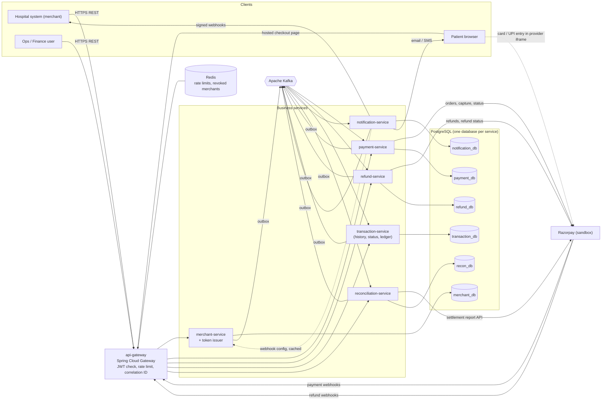

# 01 — Architecture Overview

## 1. Requirements analysis

### 1.1 Actors

| Actor | How they interact |
|---|---|
| **Hospital system** (merchant) | Server-to-server REST calls with merchant credentials. Creates payments, captures, cancels, refunds, reads transactions, receives our webhooks. |
| **Patient** | Opens a hosted checkout link in a browser and pays on the provider's checkout UI. Gets email/SMS receipts. Never calls our APIs directly. |
| **Ops / Finance user** | Internal staff. Activates/suspends merchants, runs reconciliation, resolves discrepancies, posts manual ledger reversals. |
| **Payment provider** (Razorpay) | We call its REST API; it calls our webhook endpoints. |

### 1.2 In scope

Merchant onboarding and credentials, payment collection (order → checkout → authorize → capture),
cancellation, expiry, refunds (full and partial), a double-entry ledger, merchant transaction
history, notifications (hospital webhooks, patient email, SMS abstraction), and daily
reconciliation against provider settlement data.

### 1.3 Explicitly out of scope (and why)

| Out of scope | Reason |
|---|---|
| Insurance adjudication, hospital billing, invoices | Not a payment concern — the hospital sends us a final amount. |
| Payouts from our account to hospital bank accounts | A real aggregator must do this (escrow/nodal account, payout rails). It is a separate product. The ledger still tracks what we **owe** each hospital (`MERCHANT_PAYABLE`), so payouts could be added later without redesign. |
| Merchant KYC / underwriting | Modelled only as a manual ops "activate" step. |
| Multiple providers / smart routing | Architecture is provider-independent (`PaymentProvider` port), but only one adapter (Razorpay) is built. |
| Multi-currency, FX | `currency` is stored everywhere; only `INR` is accepted. |
| Card data handling | Hosted checkout only. Card numbers and CVVs never reach our servers. |
| Any clinical data (PHI) | Data minimisation. The API rejects nothing clinical because it has no field for it. |

### 1.4 Non-functional requirements (priority order)

1. **Correctness of money** beats availability. We would rather return `503` than double-charge or
   lose a refund.
2. **Auditability** — every state change and every financial entry is traceable to a cause
   (API call, webhook, recovery job, ops user) and is never deleted.
3. **Idempotency everywhere** — every write API, every event consumer, every webhook handler.
4. **At-least-once delivery + idempotent processing.** We do **not** claim exactly-once across
   independent systems.
5. **Eventual consistency** between services, with bounded, observable lag.
6. **Resource-efficient local development** (8 GB RAM laptop).

### 1.5 Assumptions

- We operate as a payment aggregator with **one** Razorpay account. Hospitals are tenants inside
  our system, not sub-merchants inside Razorpay. (Razorpay Route / split settlements would be the
  production alternative; out of scope.)
- Amounts are INR. Razorpay expresses amounts in paise (integer); we store `NUMERIC(19,2)` rupees and
  convert only inside the provider adapter.
- Reconciliation "business day" is the **Asia/Kolkata** calendar day (the provider's reporting
  day), while all timestamps are stored in **UTC**.

---

## 2. Services and boundaries

Six business services plus an edge gateway. Each boundary below is drawn around **data ownership and
rate of change**, not around nouns.

| Service | Owns (source of truth for) | Does NOT own |
|---|---|---|
| **api-gateway** | Routing, edge authentication, rate limiting, correlation IDs | Any business data |
| **merchant-service** | Merchants, credentials (API keys), merchant configuration, webhook settings, token issuance | Payments, money |
| **payment-service** | Payments, provider orders, payment attempts, payment state machine, provider integration for payments, payment webhooks, payment recovery | Refunds, ledger balances |
| **refund-service** | Refunds, refund attempts, refundable-amount accounting, refund webhooks | Payment state |
| **transaction-service** (designed as *ledger-service*) | Transaction history and status, financial transactions (journal), ledger accounts, ledger entries, merchant reports | Operational payment/refund state |
| **notification-service** | Notification records, delivery attempts, hospital webhook delivery, email/SMS | What happened to the payment (it only reports it) |
| **reconciliation-service** | Settlement files/records, reconciliation batches and results, discrepancy workflow | The ledger (it never writes to it) |

### Why these six and not more or fewer

- **Refund is separate from payment** because refunds have their own lifecycle, their own provider
  calls, their own concurrency hazard (cumulative amount), and happen days after capture. Putting
  them in payment-service would make the payment aggregate grow forever. It is also the boundary
  the requirements ask for. *Trade-off accepted:* refund-service needs a local copy of
  captured amounts (see §4.3).
- **Ledger is separate** because financial records have different rules (append-only, double-entry,
  never deleted) and different consumers (finance, reports, reconciliation). Payment and refund
  services describe *operational* state; the ledger describes *money*.
- **Notification is separate** because delivery to hospital endpoints is slow, flaky and retried
  for hours. Isolating it means a hospital's broken webhook endpoint can never slow down payment
  processing.
- **Reconciliation is separate** because it is batch-oriented, file-heavy and run by finance — a
  completely different load profile from the online payment path.
- **No separate "auth service", "config server" or "discovery server".** Merchant-service already
  owns credentials, so it issues tokens. Config comes from Spring profiles + environment variables.
  Service discovery comes from Docker/Kubernetes DNS. Each of those extra services would be one more
  JVM on an 8 GB laptop for no interview-relevant benefit.

### Internal structure of each service

Pragmatic layered/hexagonal style, identical in every service so they are easy to navigate:

```
com.hpg.<service>
├── api/              REST controllers, request/response DTOs, DTO mappers, exception handler
├── application/      Use-case services (transaction boundaries live here), commands
├── domain/           Entities, value objects, state machines, domain exceptions, ports (interfaces)
└── infrastructure/   JPA repositories, provider adapters, Kafka producers/consumers, config
```

- Controllers only translate HTTP ↔ commands/DTOs. No business logic.
- JPA entities live in `domain` and are **never** returned from controllers (DTOs only).
  We deliberately do *not* keep a separate pure domain model plus JPA model — that duplication is
  over-engineering at this size, and it is a common interview discussion point.
- External systems are behind ports (`PaymentProvider`, `SmsSender`, `EmailSender`,
  `SettlementReportSource`) so adapters can be swapped and mocked.

### Shared libraries (kept deliberately small)

| Module | Contents | Rule |
|---|---|---|
| `platform/common` | `Money`, UUIDv7 ids, error codes, correlation-ID rules, masking, AES-GCM field encryption — plain Java, no Spring | No business logic, no entities |
| `platform/web-support` | Servlet (Spring MVC) plumbing, auto-configured: Problem Details exception handler, correlation-ID filter, JWT role mapping, `MerchantPrincipal`, pagination helpers | Not used by the reactive gateway |
| `platform/event-contracts` | Event envelope, event payload records, topic names | The *published language* between services; versioned |
| `platform/messaging` | Transactional outbox (entity + relay), idempotent-consumer helper, Kafka error-handler config | Technical plumbing only |

Shared libraries that contain domain logic create a distributed monolith (every service must
redeploy together). These three contain plumbing and contracts only.

---

## 3. High-level architecture



Solid arrows are the main flows. The single dotted service-to-service arrow
(notification → merchant) is the **only** synchronous internal call in the design (see §4.2).

---

## 4. Communication patterns

### 4.1 Rules

1. **Clients → services:** synchronous REST through the gateway.
2. **Service → provider:** synchronous REST with timeouts, circuit breaker and bulkheads,
   **never inside a database transaction**.
3. **Service → service:** asynchronous Kafka events published via the **transactional outbox**.
4. **Data another service needs on its hot path** is replicated locally from events
   ("event-carried state transfer"), not fetched synchronously.

Why: a synchronous call chain makes availability multiplicative (three services at 99.9% each give
~99.7% for the chain) and couples deploys. Events let payment-service keep taking payments while
transaction-service is down; the ledger catches up when it returns.

### 4.2 The complete list of interactions

| From → To | Style | Why this style |
|---|---|---|
| Hospital/Ops → any service | REST via gateway | Request/response is what clients need |
| gateway → merchant-service | none at request time | JWTs are validated locally with merchant-service's public keys (JWKS, cached) |
| merchant → payment, refund, notification | Kafka `merchant.snapshots.v1` (compacted) | Payment needs limits/status on every request; a local replica avoids a sync call per payment |
| payment → refund | Kafka `payment.events.v1` | Refund needs captured amount; local `refundable_payments` replica |
| payment, refund → ledger | Kafka | Ledger posting must not block or fail the payment API |
| payment, refund, recon → notification | Kafka | Delivery is slow and retried for hours |
| ledger → reconciliation | Kafka `ledger.events.v1` | Recon keeps its own copy of internal transactions |
| notification → merchant-service | **Sync REST, cached** (`GET /internal/v1/merchants/{id}/webhook-config`) | The hospital's webhook **signing secret** must not travel through Kafka (topics are retained and widely readable). Off the hot path, behind a cache and a circuit breaker; on failure the notification is simply retried later. |
| payment, refund, recon → Razorpay | Sync REST | It is the provider's API |
| Razorpay → payment, refund | Webhooks (via gateway) | Provider push; verified by HMAC signature |

### 4.3 Consequences of eventual consistency (and how each is handled)

| Situation | Handling |
|---|---|
| Merchant config changed, payment-service replica not yet updated | Seconds of lag, acceptable. **Suspension** must be immediate, so the gateway also keeps a Redis deny-list updated from the same event and checked on every request. |
| Refund requested milliseconds after capture, before refund-service has consumed `PaymentCaptured` | `409 PAYMENT_NOT_YET_REFUNDABLE` with `Retry-After: 2`. Documented to merchants. Lag is observable via consumer-lag metrics. |
| Ledger receives `RefundCompleted` before `PaymentCaptured` (different topics) | Ledger treats a missing prerequisite as a *retryable* error; blocking retry with backoff until the capture is posted, then DLQ if it never arrives. |
| Hospital webhooks delivered out of order | Every webhook carries the full current status, `occurredAt` and a per-payment `sequence`, so the hospital can ignore stale ones. |

---

## 5. Technology choices (summary)

Full reasoning is in the [decision log](decisions.md).

| Concern | Choice |
|---|---|
| Language / framework | Java 21, Spring Boot 3.5.x, Spring Cloud 2025.0.x |
| Edge | Spring Cloud Gateway (reactive) |
| Persistence | PostgreSQL 16, Spring Data JPA/Hibernate, Flyway, optimistic locking (`@Version`) |
| Messaging | Apache Kafka (KRaft, no ZooKeeper), Spring Kafka, JSON events with explicit versions |
| Reliable publish | Transactional outbox with a polling relay (Debezium CDC documented as the production option) |
| Resilience | Resilience4j circuit breaker, retry (with jitter), bulkhead; JDK HttpClient timeouts |
| Scheduling leadership | ShedLock (Postgres-backed) so recovery jobs run once across replicas |
| Cache / rate limit | Redis — only for gateway rate limiting and the suspended-merchant deny-list |
| Security | Spring Security, Spring Authorization Server (client-credentials) in merchant-service, JWT resource servers |
| Observability | Actuator, Micrometer → Prometheus → Grafana; Micrometer Tracing + OpenTelemetry → Jaeger; JSON structured logs |
| Tests | JUnit 5, Mockito, Testcontainers (Postgres, Kafka), WireMock, Awaitility |
| Build / run | Maven multi-module, Docker, Docker Compose profiles, GitHub Actions |

---

## 6. Maven project layout (to be created in Phase 2)

```
healthcare-payment-gateway/
├── pom.xml                          parent: dependency & plugin management only
├── platform/
│   ├── common/
│   ├── web-support/
│   ├── event-contracts/
│   └── messaging/
├── services/
│   ├── api-gateway/
│   ├── merchant-service/
│   ├── payment-service/
│   ├── refund-service/
│   ├── transaction-service/
│   ├── notification-service/
│   └── reconciliation-service/
├── deploy/
│   ├── docker-compose.yml           profiles: infra, core, refund, transactions, notify, recon, obs, tools
│   ├── postgres/init/               creates one database + one user per service
│   ├── prometheus/  grafana/
│   └── env/.env.example
├── samples/                         sample requests, settlement CSVs
├── docs/
└── .github/workflows/ci.yml
```

## 7. Port map

| Component | Port |
|---|---|
| api-gateway | 8080 |
| merchant-service | 8081 |
| payment-service | 8082 |
| refund-service | 8083 |
| transaction-service | 8084 |
| notification-service | 8085 |
| reconciliation-service | 8086 |
| PostgreSQL / Kafka / Redis | 5432 / 9092 / 6379 |
| Prometheus / Grafana / Jaeger UI | 9090 / 3000 / 16686 |
| Mailpit (local SMTP + UI) | 1025 / 8025 |
