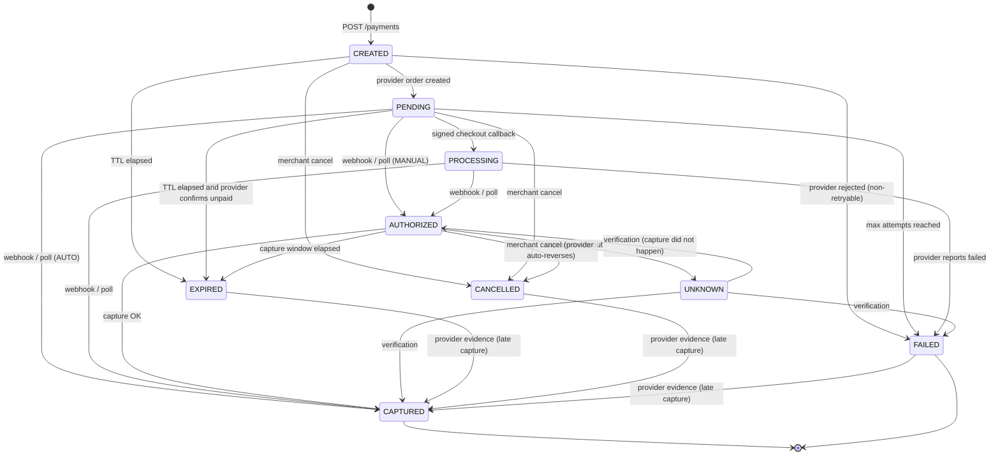
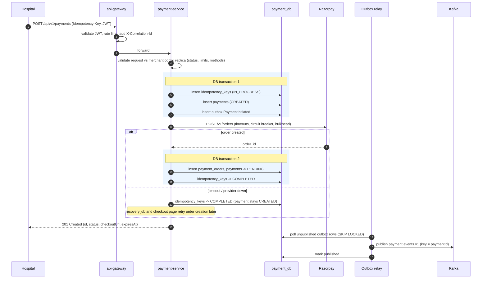
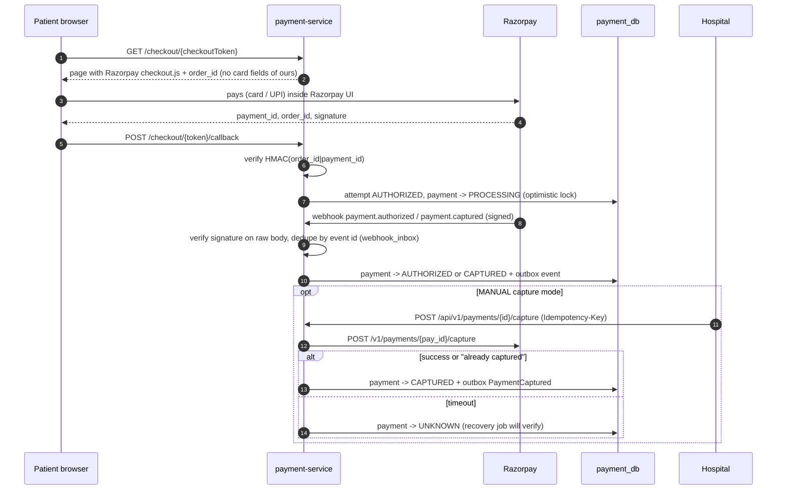

# 02 — Payment Lifecycle

## 1. Vocabulary (maps directly to tables)

| Term | Table | Meaning |
|---|---|---|
| **Payment** | `payments` | The hospital's request to collect an amount for one bill. Aggregate root. Owns the state machine. This is the `/api/v1/payments/{id}` resource. |
| **Provider order** | `payment_orders` | The order created at Razorpay for a payment. Normally exactly one per payment. |
| **Attempt** | `payment_attempts` | One try by the patient to pay on the checkout (a Razorpay `pay_...` id). A payment can have several failed attempts before one succeeds. |
| **Status history** | `payment_status_history` | Append-only audit of every transition with its trigger (API, CALLBACK, WEBHOOK, RECOVERY). |

## 2. Integration model: Razorpay Orders + hosted Standard Checkout

1. payment-service creates a Razorpay **Order** (server-to-server).
2. The patient opens our checkout link: `GET /checkout/{checkoutToken}`. This page contains no
   payment form of ours; it loads Razorpay's `checkout.js` with the order id. Card / UPI / netbanking
   details are typed into Razorpay's UI, **never ours**.
3. On success, Razorpay's checkout hands the browser `razorpay_payment_id`, `razorpay_order_id`,
   `razorpay_signature`; the page posts them to `POST /checkout/{checkoutToken}/callback`. We verify
   `HMAC_SHA256(order_id + "|" + payment_id, key_secret)` *(verify in Phase 3)*.
4. Razorpay also sends **webhooks** (`payment.authorized`, `payment.captured`, `payment.failed`,
   `order.paid`), signed with `X-Razorpay-Signature` over the raw body.
5. A **recovery job** polls Razorpay for any payment whose outcome we have not confirmed.

**Three independent signals** (browser callback, webhook, polling) converge on the same state
machine. Any one of them is enough. This is how "provider succeeded but we never got the response"
is solved: the browser callback may be lost, the webhook may be delayed, but polling eventually
asks the provider directly.

> Why not trust the browser callback alone? The browser is untrusted and unreliable (tab closed,
> network drop). The signature proves it came from Razorpay, but the callback may never arrive. The
> webhook and the poll are server-to-server.

### Capture modes (merchant configuration)

- `AUTO` — Razorpay captures immediately after authorization. Payment goes to `CAPTURED`.
- `MANUAL` — payment stops at `AUTHORIZED`; the hospital calls `POST /payments/{id}/capture`
  (e.g. after confirming the patient's procedure). Razorpay automatically reverses authorizations
  that are not captured within its capture window *(verify window in Phase 3)*.

Razorpay requires the capture amount to equal the authorized amount, so **partial capture is not
supported** *(verify in Phase 3)*.

## 3. State machine

### 3.1 States

| State | Meaning | Terminal? |
|---|---|---|
| `CREATED` | Payment persisted; provider order not yet created (or creation failed transiently) | no |
| `PENDING` | Provider order exists; waiting for the patient | no |
| `PROCESSING` | Signed checkout callback received; waiting for server-side confirmation (webhook or poll) | no |
| `AUTHORIZED` | Provider confirms funds authorized, not captured (MANUAL mode) | no |
| `CAPTURED` | Provider confirms funds captured. **This is the success state.** Refunds are allowed. | yes |
| `FAILED` | Unrecoverable: non-retryable provider rejection, or max attempts exhausted | yes |
| `CANCELLED` | Hospital cancelled before capture | yes* |
| `EXPIRED` | Payment TTL elapsed (or capture window elapsed) with provider-confirmed non-payment | yes* |
| `UNKNOWN` | A provider call that changes money (capture) timed out; outcome unknown until verified | no |

\* See "provider-evidence override" below.

**Why there is no separate `SUCCESS` state.** With Razorpay, "captured" *is* success: the capture
API answers synchronously and the funds are collected. Having both `CAPTURED` and `SUCCESS` would
force every consumer to decide which one means "money collected" — ledger posting, refund
eligibility and notifications would each pick one, and sooner or later two would disagree.
One state, one meaning. (The suggested `payment.success` topic is therefore folded into
`PaymentCaptured`; see [06](06-kafka-events.md).) This is listed as a decision for your approval.

### 3.2 Diagram



### 3.3 Rules

1. **Transitions are data, not if-statements.** A single `PaymentStateMachine` holds an
   `EnumMap<PaymentStatus, Set<PaymentStatus>>` of allowed transitions, and each transition is
   tagged with who may trigger it (`MERCHANT`, `PROVIDER_EVIDENCE`, `SYSTEM`). Anything else throws
   `InvalidPaymentStateTransitionException` → `409 Conflict` for API callers.
2. **Provider-evidence override.** Money that the provider says moved, moved. If a capture is
   confirmed (webhook or poll) for a payment we already marked `EXPIRED`, `CANCELLED` or `FAILED` (a race
   at the deadline, or a retry after the attempt budget was used), the payment moves to `CAPTURED` with `late_capture = true`, an alert metric
   fires, and the hospital is notified like any capture. The hospital then refunds through the
   normal refund API if it does not want the money. Internal state must converge to the provider's
   truth — the alternative (keeping `EXPIRED` while the patient's money sits with us) makes the
   ledger lie. Only `PROVIDER_EVIDENCE` triggers may use these two edges; merchants and timers
   cannot.
3. **Forward-only for stale events.** A `payment.authorized` webhook arriving after `CAPTURED` is
   a stale event: recorded in the webhook inbox, acknowledged with `200`, and ignored. This is how
   out-of-order webhooks are handled.
4. **Attempt failures do not fail the payment.** A failed card attempt marks that
   `payment_attempts` row `FAILED`; the payment stays `PENDING` so the patient can try again.
   After `max_attempts` (merchant config, default 3) the payment becomes `FAILED`.
5. **Every transition** writes a `payment_status_history` row and an outbox event in the same
   database transaction as the state change.

## 4. Payment initiation sequence



**Why the provider call is outside the DB transaction:** holding a DB connection and row locks
while waiting up to several seconds on the network exhausts the connection pool under load and
turns a provider slowdown into a database outage.

**Why a provider outage still returns `201`:** the hospital's request is valid and recorded. The
payment simply stays `CREATED` and the order is created later (by the checkout page on first load
or by the recovery job). This keeps our API available when Razorpay is degraded. Duplicate
Razorpay orders created by retries are harmless — an order holds no money and an order id we never
learned can never be shown to a patient.

## 5. Checkout, authorization and capture sequence



Capture is safe to retry: if a capture already happened, Razorpay rejects the second one with a
"already captured" error, which the adapter maps to success after fetching the payment to confirm.

## 6. Idempotency and duplicate prevention

Two different problems, two different mechanisms:

### 6.1 Same request sent twice (network retry, double click on the hospital's side)

`Idempotency-Key` header is **required** on `POST /payments`, `/capture`, `/cancel` and
`POST /refunds`.

- Table `idempotency_keys`, primary key `(merchant_id, operation, idempotency_key)`.
- Stores `request_hash` (SHA-256 of the canonical request body), `status`
  (`IN_PROGRESS`/`COMPLETED`), `resource_id`, `response_status`, `expires_at` (24 h).
- Flow:
  - Insert succeeds → first time; proceed.
  - Unique violation and `COMPLETED`, same hash → **replay**: return the current representation of
    the resource with the original status code and header `Idempotent-Replayed: true`.
  - Same key, **different** hash → `422 IDEMPOTENCY_KEY_REUSED`.
  - `IN_PROGRESS` → `409 REQUEST_IN_PROGRESS` with `Retry-After`.
- The key row and the payment row are inserted in **the same transaction**, so there is never a
  key without a payment or a payment without a key.
- Postgres, not Redis, because the guarantee must be atomic with the business write. A Redis key
  and a Postgres row cannot be committed together.

### 6.2 Different requests for the same bill ("patient clicks Pay twice" → hospital sends two requests)

Business-level uniqueness: a **partial unique index**

```sql
CREATE UNIQUE INDEX ux_payments_active_reference
  ON payments (merchant_id, merchant_reference)
  WHERE status NOT IN ('FAILED', 'CANCELLED', 'EXPIRED');
```

Only one *live* payment can exist per hospital bill reference. A second request returns
`409 DUPLICATE_PAYMENT` with the existing payment id. After a payment fails or expires, a new one
for the same bill is allowed.

### 6.3 Patient double-submits on the checkout page

The checkout uses one Razorpay order; Razorpay marks the order `paid` after the first successful
payment *(verify in Phase 3 whether a second payment on a paid order is blocked)*. Defensively, if
a second **captured** attempt is ever seen for an already `CAPTURED` payment, it is recorded, flagged
`DUPLICATE_CAPTURE`, alerted on, and will also surface in reconciliation as `DUPLICATE`.
We do not auto-refund it; finance decides.

## 7. Concurrency

The callback, a webhook and the recovery job can touch the same payment at the same moment.

- `payments.version` column with JPA `@Version` (optimistic locking).
- A losing writer gets `OptimisticLockException`; the application service **re-reads and
  re-applies** the transition (bounded retry, 3 tries). Because transitions are idempotent and
  forward-only, the re-applied transition is either a no-op or a legal move.
- Why optimistic, not `SELECT ... FOR UPDATE`: contention on a single payment is rare and brief;
  pessimistic locks would hold rows across more code and risk lock waits piling up.

## 8. Expiry and recovery jobs

Scheduled jobs (ShedLock ensures one runner across replicas), every 60 s, small batches:

| Job | Selects | Action |
|---|---|---|
| Order creation retry | `CREATED` older than 30 s | Create provider order → `PENDING` |
| Confirmation verification | `PROCESSING` older than 2 min, all `UNKNOWN` | `GET /orders/{id}/payments`, apply provider truth |
| Expiry | `PENDING`/`CREATED` past `expires_at` | **Ask provider first.** Paid → apply capture. Unpaid → `EXPIRED`. |
| Capture-window expiry | `AUTHORIZED` past capture window | Verify, then `EXPIRED` |

All recovery calls go through a **separate bulkhead** from the live checkout path, so a backlog of
recovery work can never starve patients who are trying to pay.

## 8a. As implemented (Phase 3)

- **Who may trigger what** is modelled as an `Authority` (MERCHANT, PROVIDER, SYSTEM) separate from the
  `TransitionSource` stored in history (MERCHANT_API, PROVIDER_RESPONSE, CHECKOUT_CALLBACK,
  PROVIDER_WEBHOOK, PROVIDER_POLL, SYSTEM). `PaymentStateMachineTest` checks all 9 × 9 × 3 = 243
  combinations against an independently written table.
- **Callback → immediate verification.** After accepting a signed callback (`PENDING → PROCESSING`), the
  service immediately fetches the payment from the provider and applies that. If the fetch fails, the
  payment stays PROCESSING and the webhook or the recovery job completes it.
- **Successful evidence is applied first** when a poll returns several attempts, so failed attempts cannot
  exhaust the attempt budget a moment before the capture is seen.
- **Evidence for an attempt that belongs to another payment is refused** (logged as an error, counted in
  `payments.evidence_conflicts`): provider ids are globally unique, so this signals bad data.
- **Duplicate capture** (a second captured attempt on an already captured payment) is recorded on the
  attempt (`duplicateCapture=true`), logged and counted — never auto-refunded.
- **Daily limit and idempotency checks** run under a per-merchant PostgreSQL advisory lock
  (`pg_advisory_xact_lock`), so concurrent creations cannot both pass "sum + amount ≤ limit".
- **If anything fails after the payment row is committed** (e.g. provider order creation), the API still
  answers 201 with status CREATED; recovery finishes it. A committed payment is never reported as an error.
- **Checkout page**: server-rendered HTML with a per-response CSP nonce; only Razorpay's script may run.
  Optional `returnUrl` (https) sends the patient back to the hospital with `paymentId` and `status`.
- **Recovery jobs** (`PaymentJobs`, ShedLock, every minute): retry order creation, verify PROCESSING /
  UNKNOWN / long-PENDING payments, expire after asking the provider, expire uncaptured authorizations.

## 9. Provider abstraction

```java
public interface PaymentProvider {
    ProviderOrder createOrder(CreateOrderCommand cmd);
    ProviderPayment fetchPayment(String providerPaymentId);
    List<ProviderPayment> fetchOrderPayments(String providerOrderId);
    ProviderPayment capture(String providerPaymentId, Money amount);
    boolean verifyCheckoutSignature(CheckoutCallback callback);
    boolean verifyWebhookSignature(byte[] rawBody, String signatureHeader);
    ProviderWebhookEvent parseWebhook(byte[] rawBody);
}
```

Refund operations live on a separate `RefundProvider` port in refund-service (interface
segregation: payment-service never needs refund calls and vice versa).

### Razorpay adapter details

- HTTP via Spring `RestClient` on the JDK `HttpClient`: connect timeout 2 s, read timeout 5 s
  (tunable). Base URL configurable so tests point at WireMock.
- Basic auth with `RAZORPAY_KEY_ID` / `RAZORPAY_KEY_SECRET` from environment variables.
- **Error mapping** to a small internal taxonomy:

| Provider outcome | Internal | Retry? |
|---|---|---|
| Connect timeout, connection refused | `ProviderUnavailableException` | yes (safe: request never reached provider) |
| Read timeout after request sent | `ProviderTimeoutException` | **only for idempotent operations**; capture → `UNKNOWN` then verify |
| HTTP 5xx | `ProviderUnavailableException` | yes, idempotent operations only |
| HTTP 429 | `ProviderRateLimitedException` | yes, with backoff |
| HTTP 400 `BAD_REQUEST_ERROR` | `ProviderRejectedException` (non-retryable) | no |
| HTTP 401 | `ProviderAuthenticationException` (config error, alert) | no |

- Resilience4j: circuit breaker per operation group (`checkout`, `recovery`), retry with
  exponential backoff + jitter (initial 200 ms, ×2, max 2 s, 3 attempts) for idempotent calls
  only, semaphore bulkheads separating live and recovery traffic.

### Simulated provider (clearly labelled)

A `SimulatedPaymentProvider`, enabled with `HPG_PAYMENT_PROVIDER=simulated` (property, not profile), lets the full flow run without
Razorpay credentials or internet access. It logs `SIMULATED PROVIDER` on every call, has a fake
checkout page with three buttons (success, failed attempt, and "success but lose the callback" to
demonstrate recovery polling); it does not send webhooks. It is **for local demos only** and is never
active unless that profile is explicitly enabled. Automated tests use **WireMock** with recorded
Razorpay-shaped responses instead.
