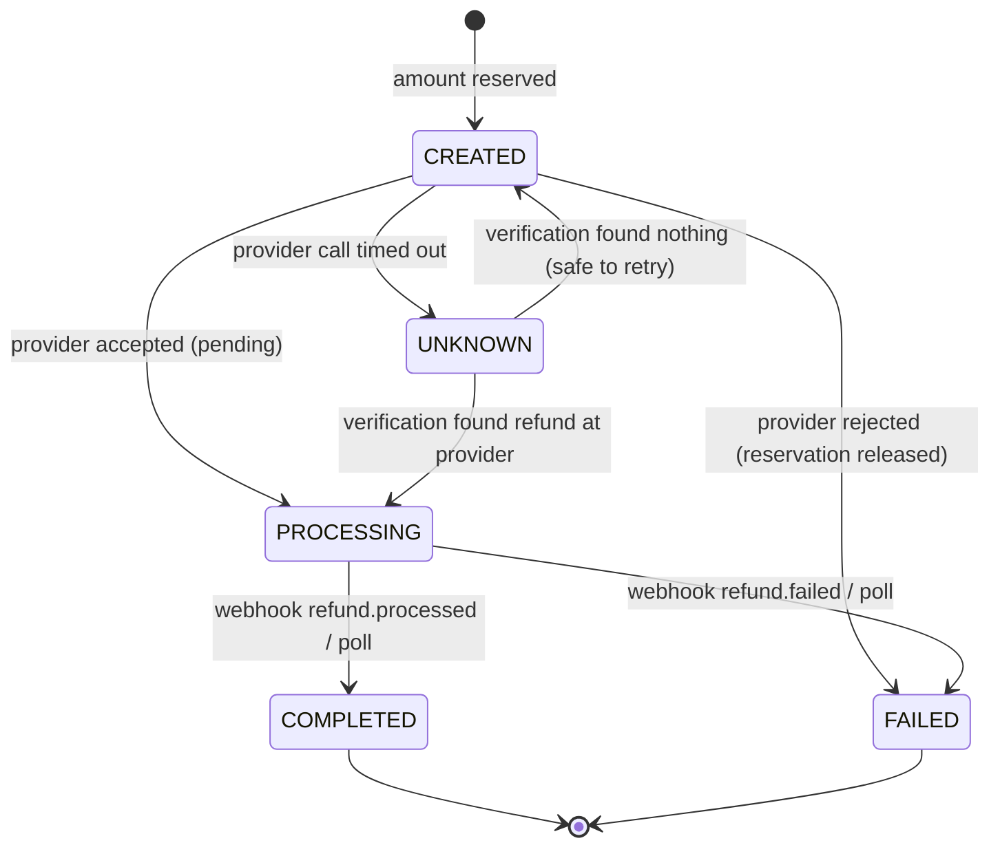
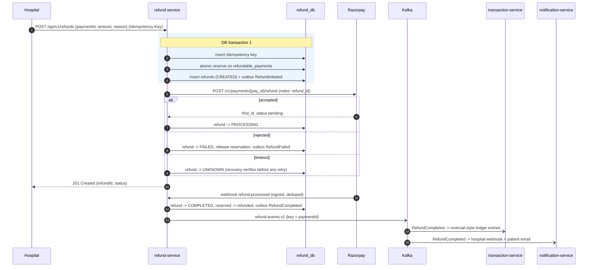

# 03 — Refund Lifecycle

## 1. Responsibilities

Full and partial refunds of captured payments, eligibility checks, the guarantee that cumulative
refunds never exceed the captured amount, provider calls, refund webhooks, recovery of refunds whose
outcome is unknown, and refund events.

## 2. Where refund-service gets payment data

refund-service never reads `payment_db`. It consumes `payment.events.v1` and maintains its own
**`refundable_payments`** table:

| Column | Meaning |
|---|---|
| `payment_id` (PK) | Our payment id |
| `merchant_id` | Owner — every refund query is scoped by it |
| `provider_payment_id` | Razorpay `pay_...` id needed for the refund call |
| `captured_amount` | From `PaymentCaptured` |
| `reserved_amount` | Sum of refunds currently in flight |
| `refunded_amount` | Sum of refunds completed |
| `currency`, `captured_at`, `version` | |

Only `PaymentCaptured` events create rows, so "payment not captured" is simply "no row".

## 3. The cumulative-amount guarantee

The classic bug: two concurrent partial refunds each check `refunded + amount <= captured`, both
pass, and together they exceed the captured amount.

We make the check and the reservation **one atomic SQL statement**:

```sql
UPDATE refundable_payments
   SET reserved_amount = reserved_amount + :amount,
       version = version + 1
 WHERE payment_id = :paymentId
   AND merchant_id = :merchantId
   AND captured_amount - refunded_amount - reserved_amount >= :amount;
-- 1 row updated  -> reservation succeeded
-- 0 rows updated -> not found, or would exceed captured amount
```

Postgres row-level locking serialises concurrent updates to the same row, and the `WHERE` clause is
re-evaluated after the lock is acquired, so two concurrent refunds can never both pass. A
`CHECK (refunded_amount + reserved_amount <= captured_amount)` constraint is the last line of
defence. On completion the amount moves from `reserved` to `refunded`; on failure the reservation
is released.

Why a reservation and not just "refunded": a refund in flight at the provider might still succeed.
If we only counted completed refunds, a merchant could fire many refunds while the first is pending.

## 4. Validation rules

| Rule | Error |
|---|---|
| No `refundable_payments` row for this payment and merchant | `409 PAYMENT_NOT_YET_REFUNDABLE` with `Retry-After: 2`. refund-service cannot tell "never captured" from "capture event not consumed yet", so it returns the retryable answer instead of guessing. Hospitals should refund only payments they have seen as `CAPTURED`. |
| Amount ≤ 0 or more than 2 decimals | `400 VALIDATION_FAILED` |
| Amount > remaining refundable | `422 REFUND_EXCEEDS_CAPTURED_AMOUNT` (response includes `remainingRefundable`) |
| Currency ≠ payment currency | `422 CURRENCY_MISMATCH` |
| Refund window exceeded (merchant config, default 180 days, provider limit applies) | `422 REFUND_WINDOW_EXPIRED` |
| Merchant suspended | `403 MERCHANT_SUSPENDED` |
| Same `Idempotency-Key` | replay (see [02 §6.1](02-payment-lifecycle.md)) |

## 5. Refund states



Razorpay refunds are asynchronous: the create call returns `pending`, and `refund.processed` /
`refund.failed` arrives later *(verify in Phase 5)*.

## 6. Duplicate refund prevention at the provider

A refund that timed out must **never** be blindly re-sent — that is how customers get refunded twice.

1. Every provider refund request carries our `refund_id` in `receipt`/`notes`.
2. On timeout the refund goes to `UNKNOWN`.
3. The recovery job lists the provider's refunds for that payment and looks for our `refund_id`.
   - Found → adopt its provider id and status.
   - Not found after a safety delay → back to `CREATED` and retry.
4. If Razorpay offers a refund idempotency header, the adapter will send it as well
   *(verify in Phase 5)* — but the design does not depend on it.

## 7. Refund sequence



## 8. System-initiated refunds

The design allows `initiated_by = MERCHANT | OPS | SYSTEM`. No automatic refunds are planned in the
first version (late captures are surfaced to the hospital instead, see [02 §3.3](02-payment-lifecycle.md)),
but the column exists so a compensation workflow can be added without a schema change.
