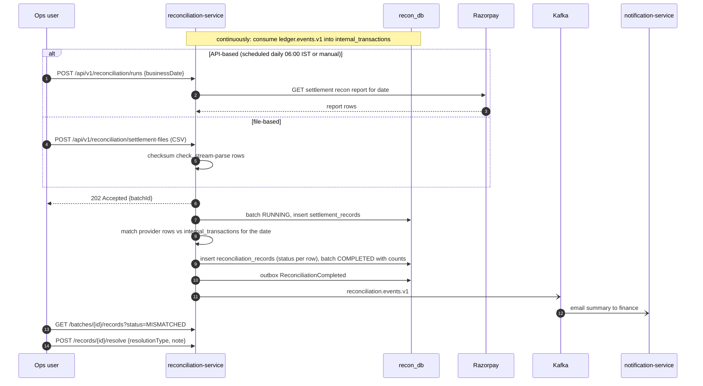

# 05 — Reconciliation

## 1. Purpose

Prove, every day, that our records and the provider's records agree — and when they do not, put the
difference in front of a human. Reconciliation **detects and reports**. It never edits payments,
refunds or the ledger. Any correction is a separate, deliberate action by ops (a ledger reversal,
a refund, a ticket to the provider) that is recorded against the discrepancy.

## 2. Inputs

| Side | Source | How it arrives |
|---|---|---|
| **Internal** | ledger transactions (`PAYMENT_CAPTURE`, `REFUND`) | reconciliation-service consumes `ledger.events.v1` (`TransactionCreated`) into its own `internal_transactions` table |
| **Provider** | settlement / transaction report | (a) CSV upload by ops, or (b) Razorpay settlement recon API (`GET /v1/settlements/recon/combined?year=&month=&day=`) *(verify in Phase 6)* |

Both provider inputs go through one port so the matching engine does not care where rows came from:

```java
public interface SettlementReportSource {
    SettlementReport fetch(LocalDate businessDate);   // API-based
}
// CSV uploads are parsed by SettlementCsvParser into the same SettlementReport model.
```

Why internal data comes from the **ledger** and not from payment-service: the ledger is the record
of money. If a capture happened at the provider but never reached the ledger (lost webhook *and*
failed polling), that is precisely the discrepancy we want to find.

## 3. CSV format (modelled on Razorpay's settlement recon report)

```csv
entity_id,type,order_id,amount,fee,tax,currency,settlement_id,settled_at,created_at
pay_N1a2b3c4d5e6f7,payment,order_N1a2b3c4d5,20000.00,400.00,72.00,INR,setl_N9z8y7x6,2026-11-13T10:30:00Z,2026-11-12T09:15:02Z
rfnd_N7g8h9i0j1k2l3,refund,,5000.00,0.00,0.00,INR,setl_N9z8y7x6,2026-11-13T10:30:00Z,2026-11-12T14:01:44Z
```

- Parsed streaming (row by row) so large files do not load into memory.
- File SHA-256 is stored with a unique constraint: uploading the **same file twice** is rejected
  (`409 DUPLICATE_SETTLEMENT_FILE`).
- Malformed rows are recorded with their row number and error; they do not abort the batch, and
  the batch summary reports them.
- Sample files (clean, missing transaction, duplicate row, amount mismatch) will be provided in
  `samples/settlement/` in Phase 6.

## 4. Matching rules

Match key: `(entity_type, provider_reference)` — the Razorpay `pay_...` / `rfnd_...` id. The
ledger transaction carries the provider reference it was posted from.

| Condition | Status |
|---|---|
| Present on both sides, same type, same amount and currency | `MATCHED` |
| Present on both sides, amount or currency differs | `MISMATCHED` |
| Internal only, and older than the expected settlement window (T+N days, configurable, default 3) | `MISSING_IN_PROVIDER` |
| Internal only, still inside the settlement window | not flagged — carried into the next run |
| Provider only | `MISSING_IN_INTERNAL_SYSTEM` |
| Same provider reference appears more than once on either side | `DUPLICATE` |
| Anything the rules cannot classify safely (type mismatch, unparseable provider row, near-day-boundary item still unmatched) | `PENDING_REVIEW` |

Amounts are compared as `BigDecimal` with `compareTo` (never `equals`: `20000.0` and `20000.00`
are not `equals` in Java). Provider fees are reported but are not a mismatch — gross amounts are
compared.

## 5. Discrepancy workflow

Every non-`MATCHED` record has a resolution lifecycle independent of its match status:

`OPEN` → `IN_REVIEW` → `RESOLVED` (with `resolution_type`, `resolution_note`, `resolved_by`,
`resolved_at`).

`resolution_type`: `PROVIDER_ERROR_RAISED`, `INTERNAL_CORRECTION_POSTED` (links to a ledger
reversal transaction ref), `TIMING_DIFFERENCE`, `ACCEPTED_AS_IS`.

Resolution changes the **reconciliation record only**. If ops decides the ledger is wrong, they post
a reversal through the ledger's admin API and paste the resulting transaction ref into the
resolution — two explicit actions, both audited.

Re-running reconciliation for a date creates a **new batch**; old batches are kept (immutable
history), and the newest batch for a date is the current view.

## 6. Sequence



## 7. Metrics

`recon_records_total{status}`, `recon_open_discrepancies` (gauge), `recon_batch_duration_seconds`,
`recon_last_successful_run_timestamp` (alert if older than 26 h).
