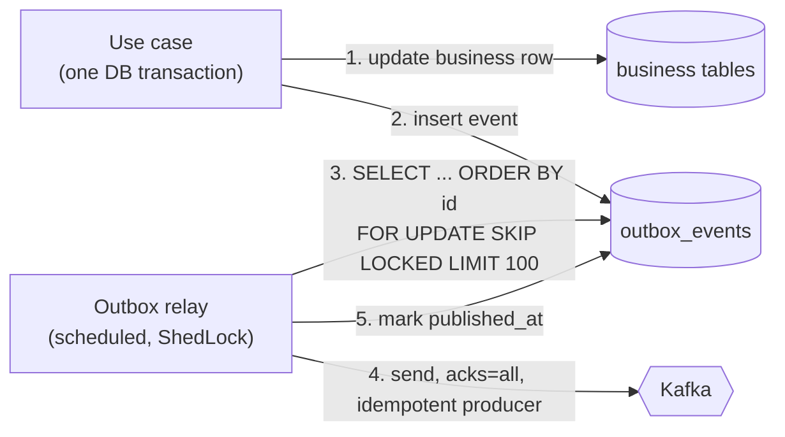

# 06 — Kafka Architecture & Events

## 1. Delivery guarantees (stated plainly)

- **Producer side:** transactional outbox + relay → every committed business change is published
  **at least once**. Duplicates are possible (relay crashes after send, before marking published).
- **Consumer side:** **at-least-once** consumption (commit offsets after processing) + **idempotent
  processing** (dedupe table and/or natural unique constraints in the same DB transaction as the
  effect).
- Net effect: each business effect is applied **effectively once** inside a service. We do **not**
  claim exactly-once across services, and we do not use Kafka transactions, because they only cover
  Kafka-to-Kafka flows, not our Postgres writes.

## 2. Topic design — one topic per aggregate, not per event type

| Topic | Key | Partitions (local / prod) | Retention | Producer |
|---|---|---|---|---|
| `payment.events.v1` | `paymentId` | 3 / 12 | 7 d | payment-service |
| `refund.events.v1` | `paymentId` | 3 / 12 | 7 d | refund-service |
| `ledger.events.v1` | `paymentId` | 3 / 6 | 7 d | ledger-service |
| `merchant.snapshots.v1` | `merchantId` | 1 / 3 | **compacted** | merchant-service |
| `reconciliation.events.v1` | `businessDate` | 1 / 1 | 30 d | reconciliation-service |
| `notification.events.v1` | `notificationId` | 1 / 3 | 7 d | notification-service |
| `<topic>.dlt` | same as source | 1 / 3 | 30 d | Spring Kafka error handler |
| `<topic>.retry-N` | same as source | as source | 1 d | Spring Kafka retry topics (notification only) |

**Why not one topic per event type** (`payment.authorized`, `payment.captured`, …) as suggested:
Kafka only orders messages **within a single partition of a single topic**. If `PaymentAuthorized`
and `PaymentCaptured` live on different topics, a consumer can see "captured" before "authorized"
for the same payment. Putting all events of one aggregate on one topic, keyed by the aggregate id,
gives per-payment ordering for free. The suggested names become **event types** inside the
envelope, so nothing is lost:

| Suggested topic | Event type (on topic) |
|---|---|
| `payment.initiated` | `PaymentInitiated` (payment.events.v1) |
| `payment.authorized` | `PaymentAuthorized` (payment.events.v1) |
| `payment.captured` + `payment.success` | `PaymentCaptured` (payment.events.v1) — see [02 §3.1](02-payment-lifecycle.md) |
| `payment.failed` | `PaymentFailed` (payment.events.v1) |
| — (added) | `PaymentCancelled`, `PaymentExpired` (payment.events.v1) |
| `refund.initiated` / `completed` / `failed` | `RefundInitiated` / `RefundCompleted` / `RefundFailed` (refund.events.v1) |
| `transaction.created` | `TransactionCreated` (ledger.events.v1) |
| `reconciliation.completed` | `ReconciliationCompleted` (reconciliation.events.v1) |
| `notification.failed` | `NotificationFailed` (notification.events.v1) |

Refund events are keyed by **`paymentId`** (not `refundId`) so all refunds of one payment are
ordered relative to each other.

`merchant.snapshots.v1` is **log-compacted** and carries the *full current state* of a merchant
(status, limits, methods, webhook URL — never secrets). Any service can rebuild its replica by
reading the topic from the beginning; Kafka keeps only the latest snapshot per merchant.

## 3. Event envelope

```json
{
  "eventId": "01933f7e-6b1c-7c2a-9d4e-5f6a7b8c9d0e",
  "eventType": "PaymentCaptured",
  "eventVersion": 1,
  "occurredAt": "2026-11-12T09:15:04.218Z",
  "producer": "payment-service",
  "aggregateType": "Payment",
  "aggregateId": "3f9c2a51-8a7e-4f0e-9a43-1d2b6c7e8f90",
  "aggregateVersion": 5,
  "merchantId": "b1e7c3d2-...",
  "correlationId": "c0a8012e-hpg-7f3a",
  "causationId": "rzp-evt-Ny1x2...",
  "payload": {
    "paymentId": "3f9c2a51-8a7e-4f0e-9a43-1d2b6c7e8f90",
    "merchantReference": "BILL-2026-000981",
    "amount": "20000.00",
    "currency": "INR",
    "providerPaymentId": "pay_N1a2b3c4d5e6f7",
    "providerOrderId": "order_N1a2b3c4d5",
    "capturedAt": "2026-11-12T09:15:04.101Z",
    "lateCapture": false
  }
}
```

- `eventId`: UUIDv7 (time-ordered) — the dedupe key.
- `aggregateVersion`: the payment's `@Version` at the time — consumers can detect and drop stale
  events.
- `correlationId`: the business request id that started the flow (from `X-Correlation-Id`).
- `causationId`: the id of the thing that directly caused this event (an inbound webhook event id,
  another event id, or the API request id).
- Money is a **string** decimal — never a JSON float.
- Kafka headers additionally carry `eventType`, `eventVersion` and W3C `traceparent`, so consumers
  can filter or route without deserialising the payload and traces span services.
- **PII:** payment events carry patient email/phone only where a downstream consumer needs them
  (notification). Never card data, never clinical data.

## 4. Versioning rules

- Within `v1`: **additive changes only** (new optional fields). Consumers are configured with
  `FAIL_ON_UNKNOWN_PROPERTIES = false`, so producers can add fields first.
- Breaking change → new `eventVersion` and, if consumers cannot handle both, a new topic
  (`payment.events.v2`) with a dual-publish period.
- Contracts live in `platform/event-contracts` as Java records, and every event has a worked example
  in [docs/events/](events/README.md), captured from the running system.
- Why JSON and not Avro + Schema Registry: one less container on an 8 GB laptop and human-readable
  messages while learning. Avro/Protobuf with a registry and compatibility checks is the production
  recommendation and is listed in the decision log.

## 5. Transactional outbox



- The business change and the event are committed **atomically**. There is no "saved but not
  published" or "published but rolled back" window.
- The relay preserves order: it processes rows by `id` (a sequence), and if sending a row fails it
  **stops the batch** rather than skipping ahead, so later events for the same payment are never
  published before earlier ones.
- One active relay per service (ShedLock). Each event is sent and acknowledged before the next is sent,
  and the batch stops at the first failure, so a later event for an aggregate can never overtake an
  earlier one. That costs a round trip per event; with higher volume the options are sharding rows by
  `hash(aggregate_id) % N` across N relays, or moving to CDC. The relay holds its database transaction
  across the sends (to claim rows `FOR UPDATE SKIP LOCKED` and mark them published atomically), which is
  bounded by a short send timeout and the stop-on-first-failure rule.
- Published rows are deleted by a cleanup job after 7 days (outbox rows are transport, not records —
  the business tables and the ledger are the records).
- If Kafka is down, rows accumulate; the API keeps working; the relay drains the backlog when Kafka
  returns. Metric: `outbox_pending_events` with an alert.
- **Production option:** Debezium CDC reading the Postgres WAL instead of polling (lower latency, no
  polling load). Not used locally — Kafka Connect alone needs ~1 GB RAM.

## 6. Consumers, retries and dead letters

| Consumer (group) | Topics | Purpose | Retry style |
|---|---|---|---|
| payment-service `payment-merchant-replica` | merchant.snapshots.v1 | merchant config replica | blocking |
| refund-service `refund-payment-replica` | payment.events.v1 (`PaymentCaptured`) | `refundable_payments` | blocking |
| refund-service `refund-merchant-replica` | merchant.snapshots.v1 | merchant status/limits | blocking |
| ledger-service `ledger-posting` | payment.events.v1, refund.events.v1 | postings | **blocking** (order matters) |
| notification-service `notification-service-payment-events` | payment.events.v1 | create notification rows | blocking |
| notification-service `notification-merchant-replica` | merchant.snapshots.v1 | webhook URL, preferences | blocking |
| reconciliation-service `recon-internal-txns` | ledger.events.v1 | `internal_transactions` | blocking |

- **Blocking retry** (`DefaultErrorHandler` + `ExponentialBackOffWithMaxRetries`, jittered): the
  partition waits while the record is retried. Used where **order matters** (ledger, replicas).
- **Non-blocking retry topics are not used.** The plan in Phase 1 was to use them for notification
  intake. They turned out to be unnecessary: the consumer only *creates* notification rows, which is
  fast and fails only if the database or the merchant replica is unavailable — both worth waiting for.
  The retries that genuinely span hours (delivering a webhook to a hospital) never happen on a Kafka
  thread at all; they are a `next_attempt_at` column in `notifications`. One retry mechanism fewer,
  and the long-running one is visible and queryable in SQL.
- **Not retried:** deserialisation errors and validation errors (poison pills) go straight to
  `<topic>.dlt` — retrying cannot fix them.
- **DLT handling:** every DLT has a metric (`kafka_dlt_records_total`) and an alert. Dead-lettering is
  done by our own `DeadLetterRecoverer` rather than Spring's `DeadLetterPublishingRecoverer`, for two
  reasons: the **original bytes** are forwarded (so a record that failed to parse can still be read and
  replayed exactly as it arrived), and the dead-letter path carries one value type instead of depending
  on a serializer per failure kind. Headers record the original topic, partition, offset, the service
  that gave up, and the exception. A replay tool is a Phase 8 stretch; replay is safe because consumers
  deduplicate.

### Consumer idempotency

```sql
CREATE TABLE processed_events (
  consumer_group VARCHAR(100) NOT NULL,
  event_id       UUID         NOT NULL,
  processed_at   TIMESTAMPTZ  NOT NULL DEFAULT now(),
  PRIMARY KEY (consumer_group, event_id)
);
```

Insert into `processed_events` **in the same DB transaction** as the effect. If the insert hits the
primary key, the event was already processed: skip and acknowledge. Rows older than the topic
retention + margin are purged.

## 7. End-to-end event flow

```mermaid
flowchart LR
    MS["merchant-service"] -->|MerchantSnapshot| MT{{"merchant.snapshots.v1"}}
    PS["payment-service"] -->|"PaymentInitiated / Authorized /<br/>Captured / Failed / Cancelled / Expired"| PT{{"payment.events.v1"}}
    RS["refund-service"] -->|"RefundInitiated / Completed / Failed"| RT{{"refund.events.v1"}}
    LS["ledger-service"] -->|TransactionCreated| LT{{"ledger.events.v1"}}
    RC["reconciliation-service"] -->|ReconciliationCompleted| CT{{"reconciliation.events.v1"}}
    NS["notification-service"] -->|NotificationFailed| NT{{"notification.events.v1"}}

    MT --> PS
    MT --> RS
    MT --> NS
    PT -->|Captured| RS
    PT -->|Captured| LS
    PT -->|"Captured / Failed /<br/>Cancelled / Expired"| NS
    RT -->|Completed| LS
    RT -->|"Completed / Failed"| NS
    LT --> RC
    CT --> NS
```



`notification.events.v1` (`NotificationFailed`) has no consuming service in v1; it exists for
alerting and for a future ops tool, and is visible in Grafana via a metric.

## 8. Kafka configuration highlights

| Setting | Value | Why |
|---|---|---|
| Producer `acks` | `all` | Don't lose acknowledged events |
| `enable.idempotence` | `true` | No duplicates from producer-level retries |
| Consumer `enable.auto.commit` | `false` (Spring `AckMode.RECORD`/`BATCH`) | Commit only after processing |
| `isolation.level` | `read_committed` | Harmless, future-proof |
| `auto.offset.reset` | `earliest` | A new consumer group must not silently skip events |
| Broker (local) | 1 broker, RF 1, KRaft | Laptop |
| Broker (prod) | ≥3 brokers, RF 3, `min.insync.replicas=2` | Survive one broker loss without data loss |
