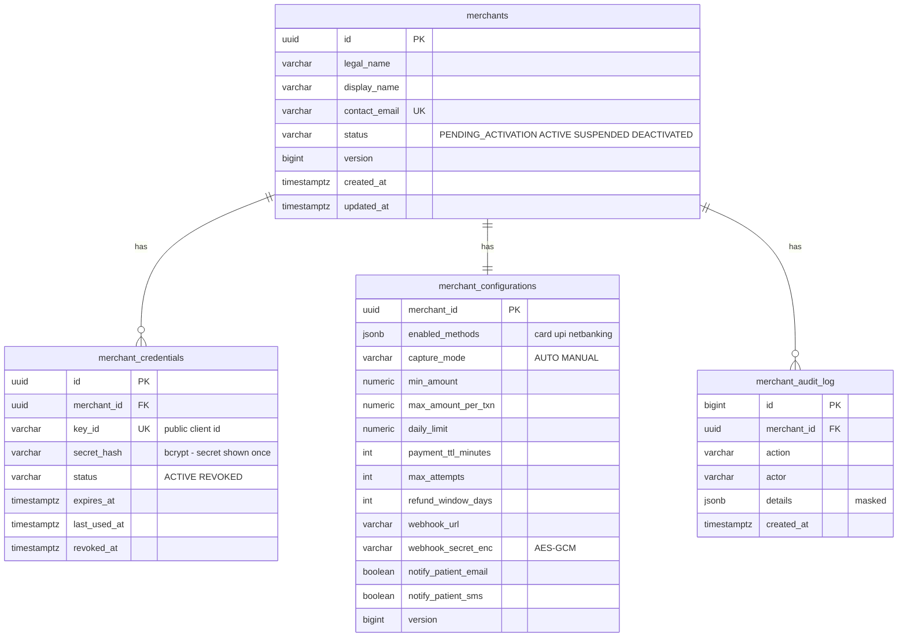
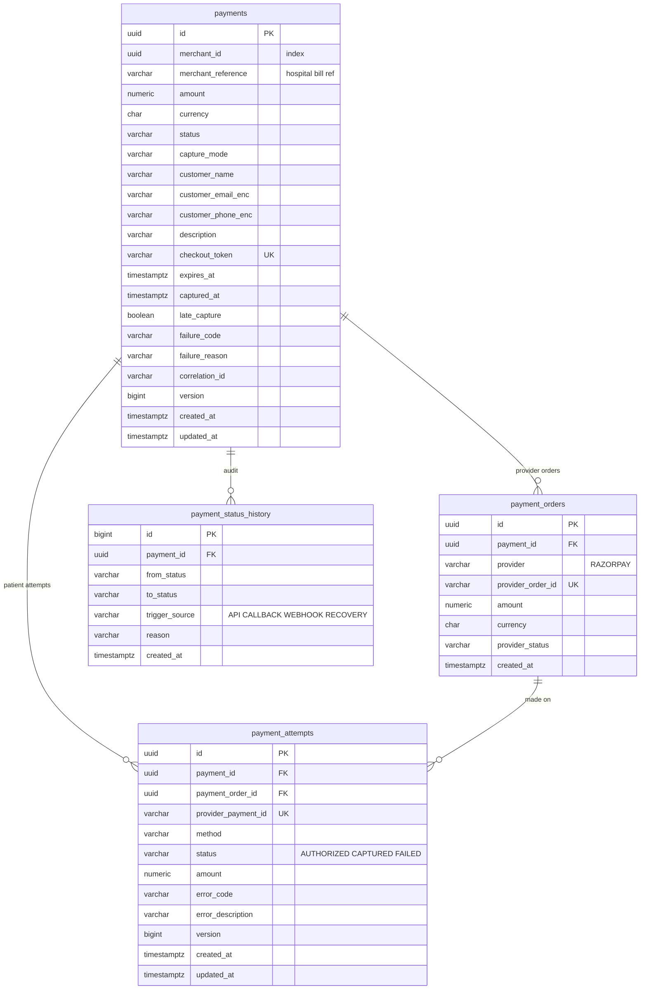
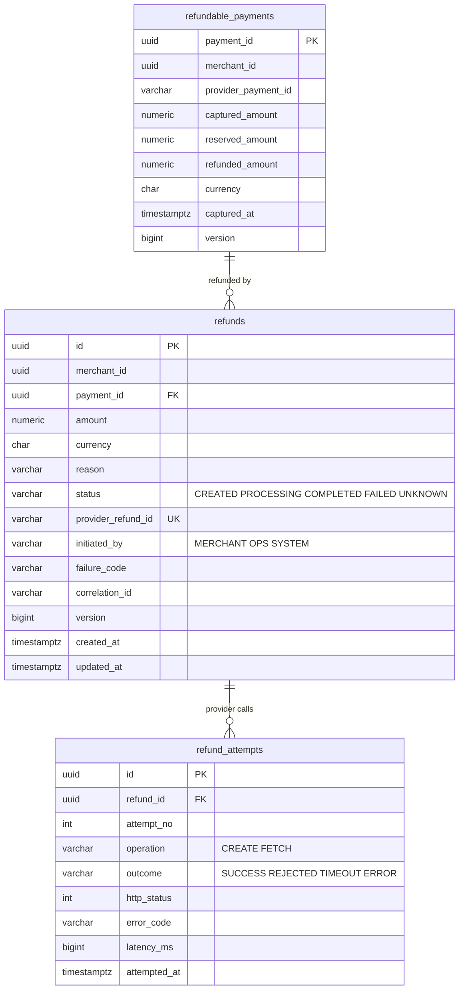
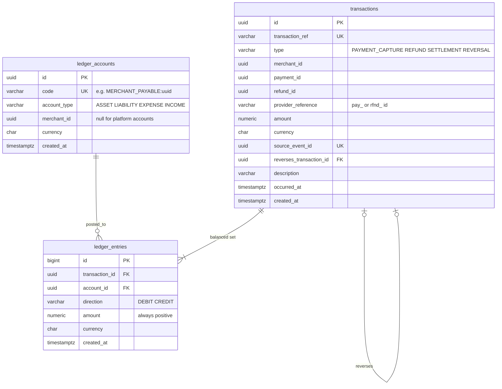
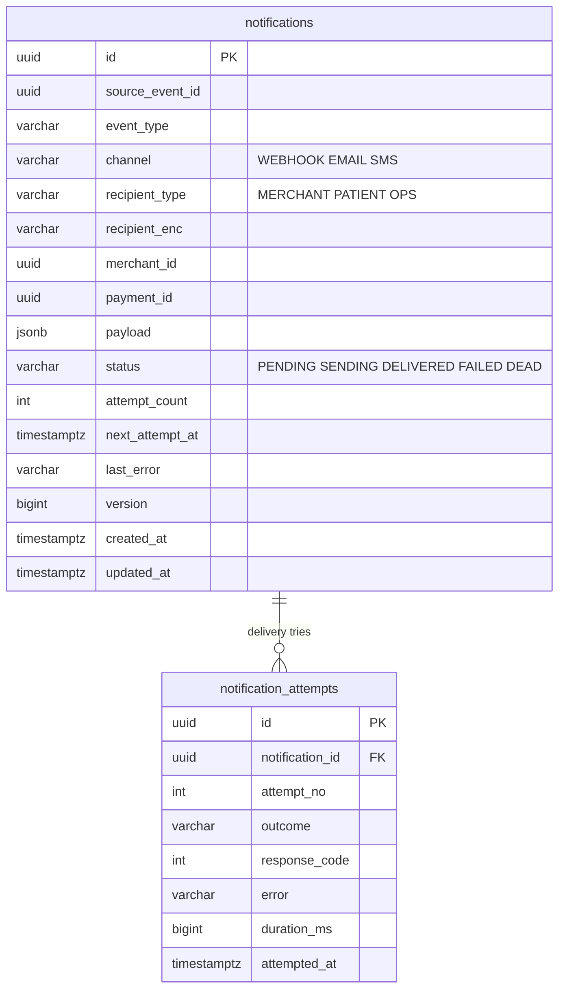
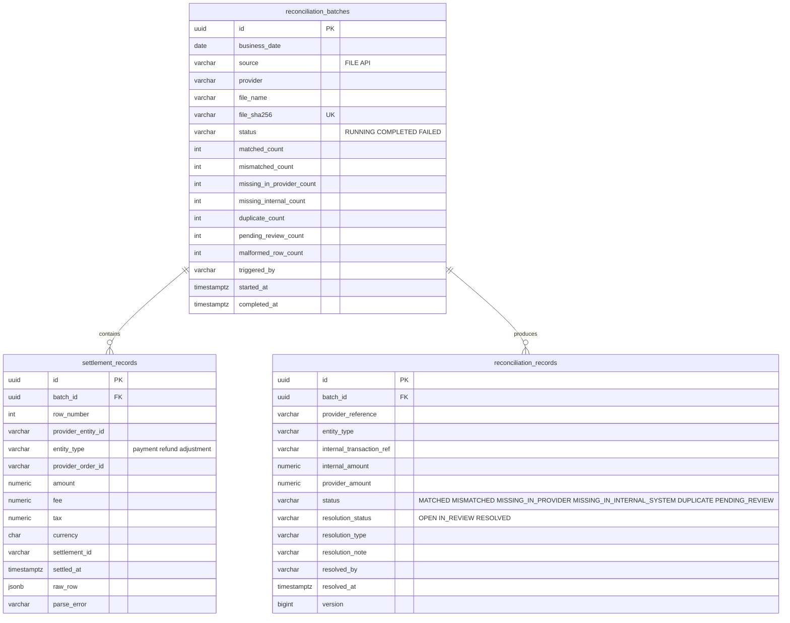

# 07 — Data Model & Database Ownership

## 1. Ownership rules

- **One logical database per service** (`merchant_db`, `payment_db`, `refund_db`, `ledger_db`,
  `notification_db`, `recon_db`), each with **its own database user** that has privileges only on
  its own database. A service physically cannot query another service's tables.
- Locally all six databases live in **one PostgreSQL container** to save RAM. In production they
  would be separate instances (or at least separate clusters for ledger/payment), so one service's
  load or outage cannot affect another.
- Data another service needs is **replicated through events** into tables that the consumer owns
  (`merchant_config_replica`, `refundable_payments`, `internal_transactions`). Replicas are
  read-only from the owner's point of view and are rebuilt from Kafka if lost.
- **No cross-database foreign keys.** IDs from other services are stored as plain UUID columns.

## 2. Conventions (all services)

| Concern | Convention |
|---|---|
| Primary keys | `UUID` generated in the application (UUIDv7, time-ordered → index-friendly). Ledger entries and outbox use `BIGINT` identity for ordering. |
| Money | `NUMERIC(19,2)` + `currency CHAR(3)`; Java `BigDecimal` wrapped in a `Money` value object. Never `double`/`float`. Paise conversion only inside the Razorpay adapter. |
| Timestamps | `TIMESTAMPTZ`, application and JVM run in UTC (`-Duser.timezone=UTC`, `hibernate.jdbc.time_zone=UTC`). |
| Audit fields | `created_at`, `updated_at`, `created_by`, `updated_by` (Spring Data JPA auditing) on mutable tables. |
| Optimistic locking | `version BIGINT NOT NULL` + `@Version` on every mutable aggregate. |
| Enums | `VARCHAR` + `CHECK` constraint (readable, easy to extend with a migration; Postgres enums are awkward to change). |
| Migrations | Flyway, `V{n}__description.sql`, forward-only. Never edit an applied migration. |
| Soft delete | Not used for financial data. Financial rows are immutable; corrections are new rows. |
| PII at rest | Patient email/phone and hospital webhook secrets encrypted with AES-GCM via a JPA `AttributeConverter`; key from env / secrets manager. |

## 3. merchant_db



Plus `outbox_events`, `shedlock`. Spring Authorization Server's registered-client lookup is backed by
`merchant_credentials` (custom `RegisteredClientRepository`), so we do not add its default tables.

## 4. payment_db



Supporting tables in `payment_db`:

| Table | Key columns |
|---|---|
| `idempotency_keys` | PK `(merchant_id, operation, idempotency_key)`, `request_hash`, `status`, `resource_id`, `response_status`, `expires_at` |
| `outbox_events` | `id BIGINT identity`, `event_id UUID UK`, `aggregate_type`, `aggregate_id`, `event_type`, `topic`, `message_key`, `payload JSONB`, `headers JSONB`, `created_at`, `published_at`, `attempts`, `last_error` |
| `webhook_inbox` | `provider_event_id UK`, `event_type`, `payload JSONB`, `received_at`, `processed_at`, `status`, `outcome` (`APPLIED` / `STALE_IGNORED` / `FAILED`) |
| `merchant_config_replica` | `merchant_id PK`, status, limits, methods, capture mode, TTL, `snapshot_version` |
| `processed_events` | PK `(consumer_group, event_id)` |
| `shedlock` | ShedLock standard table |

Key indexes and constraints:

```sql
-- one live payment per hospital bill
CREATE UNIQUE INDEX ux_payments_active_reference ON payments (merchant_id, merchant_reference)
  WHERE status NOT IN ('FAILED','CANCELLED','EXPIRED');
-- merchant listing and recovery scans
CREATE INDEX ix_payments_merchant_created ON payments (merchant_id, created_at DESC);
CREATE INDEX ix_payments_recovery ON payments (status, updated_at)
  WHERE status IN ('CREATED','PENDING','PROCESSING','AUTHORIZED','UNKNOWN');
-- relay scan
CREATE INDEX ix_outbox_unpublished ON outbox_events (id) WHERE published_at IS NULL;
ALTER TABLE payments ADD CONSTRAINT ck_payments_amount_positive CHECK (amount > 0);
```

## 5. refund_db



```sql
ALTER TABLE refundable_payments ADD CONSTRAINT ck_refund_total
  CHECK (refunded_amount >= 0 AND reserved_amount >= 0
         AND refunded_amount + reserved_amount <= captured_amount);
```

Plus `idempotency_keys`, `refund_outbox_events` (same shape as `outbox_events`), `webhook_inbox`,
`merchant_status_replica`, `processed_events`, `shedlock`.

## 6. ledger_db



Plus `outbox_events`, `processed_events`. Immutability and balance enforcement: see [04 §3](04-ledger.md).

## 7. notification_db



`UNIQUE (source_event_id, channel, recipient_type)` — the same event can never produce two webhooks
or two emails to the same party, even if the event is consumed twice. Plus
`merchant_notification_replica`, `processed_events`, `outbox_events`, `shedlock`.

## 8. recon_db



Plus `internal_transactions` (replica of ledger transactions: `transaction_ref`, type,
`provider_reference`, amount, currency, `occurred_at`, `merchant_id`), `processed_events`,
`outbox_events`, `shedlock`.

## 9. Table list vs the requested list

| Requested | Present | Notes |
|---|---|---|
| merchants, merchant_credentials, merchant_configurations | ✅ | + `merchant_audit_log` |
| payment_orders, payments, payment_attempts, idempotency_keys, outbox_events | ✅ | + `payment_status_history`, `webhook_inbox`, `merchant_config_replica` |
| refunds, refund_attempts, refund_outbox_events | ✅ | + `refundable_payments`, `idempotency_keys`, `webhook_inbox` |
| transactions, ledger_accounts, ledger_entries | ✅ | |
| notifications, notification_attempts | ✅ | |
| reconciliation_batches, reconciliation_records, settlement_records | ✅ | + `internal_transactions` |

Every added table exists for a reason stated in the lifecycle documents (audit, dedupe, or a local
replica that avoids a synchronous call).
