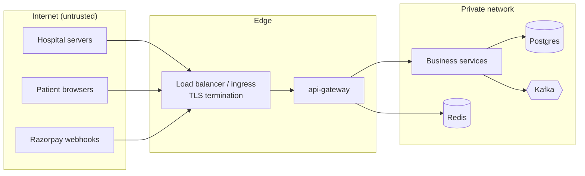

# 09 — Security Architecture

## 1. Trust boundaries

Services are not reachable from the internet; only the gateway is. Internal routes
(`/internal/**`, `/actuator/**` except health) are **not** routed by the gateway.

## 2. Authentication

### 2.1 Merchants (hospital servers) — OAuth2 client credentials

1. Merchant creates an API key in merchant-service → receives `key_id` + `key_secret` **once**.
   We store only a bcrypt hash of the secret.
2. Merchant calls `POST /oauth2/token` with HTTP Basic `key_id:key_secret`,
   `grant_type=client_credentials`.
3. merchant-service (embedded **Spring Authorization Server**) issues an RS256 **JWT, 15 min TTL**,
   claims: `sub` (key id), `mid` (merchant id), `roles: [MERCHANT]`, `scope`.
4. Gateway and every service validate the JWT locally using the JWKS endpoint (cached). No call to
   merchant-service per request.

Why this rather than sending the raw API key on every request (Razorpay/Stripe style):

- The long-lived secret crosses the wire once per 15 minutes instead of on every request.
- Validation is local and cheap (signature check) — no shared key database for the gateway.
- It is standard OAuth2, which is what interviewers expect to hear about.

Trade-off: a token stays valid until expiry even after a key is revoked or a merchant is suspended.
Mitigation: merchant-service publishes the snapshot event; the gateway puts the merchant id in a
**Redis deny-list** and rejects its tokens immediately. Key rotation: merchants can hold two active
keys at once to rotate without downtime.

### 2.2 Ops users

Locally: an `ops` OAuth client seeded from environment variables gets `roles: [OPS]`.
Production recommendation: human users sign in through the company IdP (OIDC — Okta/Azure AD/
Keycloak) with MFA; services trust that issuer as well. Not built locally because running Keycloak
costs ~500 MB+ RAM.

### 2.3 Service-to-service

The one sync internal call (notification → merchant webhook config) uses a client-credentials token
with role `SERVICE`. Production: mTLS between services (service mesh) in addition.

## 3. Authorization

| Role | Can |
|---|---|
| `MERCHANT` | Own payments, refunds, transactions, configuration, keys |
| `OPS` | Merchant activation/suspension, reconciliation, ledger admin, discrepancy resolution |
| `SERVICE` | `/internal/**` endpoints |

- Method-level `@PreAuthorize` on application services, not just URL rules.
- **Tenant isolation:** every repository query for merchant data includes `merchant_id` taken
  from the token. There is no repository method that loads a payment by id alone for merchant
  APIs. This prevents IDOR (one hospital reading another's payments) — the most common real-world
  API vulnerability.

## 4. Webhook security

### Inbound (Razorpay → us)

1. Read the **raw body bytes** (before any JSON parsing — re-serialised JSON will not match the
   signature).
2. `HMAC_SHA256(raw_body, RAZORPAY_WEBHOOK_SECRET)` compared with `X-Razorpay-Signature` using
   `MessageDigest.isEqual` (constant time).
3. Invalid → `401`, metric `webhook_signature_failures_total`, no processing.
4. **Replay protection:** dedupe on `X-Razorpay-Event-Id` in `webhook_inbox` (unique), and reject
   events whose `created_at` is older than 48 h (Razorpay retries for up to ~24 h *(verify)*).
5. Body size limit (64 KB) at the gateway.

### Outbound (us → hospitals)

HMAC-SHA256 over `timestamp.body` with a per-merchant secret, timestamp header for replay
protection, event id for dedupe (see [08 §8](08-api-contracts.md)). Webhook URLs must be `https`
in non-local profiles, and we block private/loopback IP ranges to prevent SSRF against our own
network.

### Checkout callback

The checkout token in the URL is 32 random bytes (unguessable) and only valid until the payment
expires. The callback's Razorpay signature is verified server-side.

## 5. Rate limiting

Spring Cloud Gateway `RequestRateLimiter` with Redis token bucket:

| Key | Limit (default) |
|---|---|
| Merchant id (from JWT) | 50 req/s, burst 100 |
| Client IP on `/oauth2/token` and `POST /merchants` | 5 req/s — slows credential stuffing |
| Webhook routes | 100 req/s per IP |

## 6. Secrets and data protection

| Secret / data | Storage |
|---|---|
| Razorpay key secret, webhook secret | Environment variables locally (`.env`, git-ignored, `.env.example` committed); a secrets manager (Vault / AWS Secrets Manager) in production |
| JWT signing key | Generated RSA key pair loaded from a keystore path in env; rotated with `kid` |
| DB passwords | Env vars; one user per service |
| Merchant API secrets | bcrypt hash only |
| Merchant webhook secrets | AES-256-GCM encrypted at rest (key from env / KMS) |
| Patient email/phone | AES-256-GCM encrypted at rest; masked in responses and logs |
| Card number, CVV, UPI PIN | **Never received.** Hosted checkout. |

No credentials are hardcoded or committed. CI runs a secret scanner (gitleaks) on every push.

## 7. Logging hygiene

- A Logback masking converter redacts known patterns (email, phone, `key_secret`, `Authorization`
  headers, 13–19 digit numbers that could be PANs) as a safety net.
- The primary control is **not logging sensitive objects at all**: DTOs that hold PII override
  `toString()` to mask fields; request/response body logging is off.
- **Audit log:** security-relevant actions (key created/revoked, merchant suspended, config
  changed, discrepancy resolved, ledger reversal) are written to an audit table with actor,
  timestamp, correlation id and masked details.

## 8. TLS

- Locally: plain HTTP inside Docker; optional self-signed TLS on the gateway via a Spring Boot SSL
  bundle for practice.
- Production: TLS 1.2+ (prefer 1.3) at the load balancer, HSTS, modern cipher suites; TLS or mTLS
  for internal traffic, Postgres (`sslmode=verify-full`) and Kafka (SASL_SSL).

## 9. PCI DSS considerations (not a compliance claim)

**This project is not PCI DSS compliant and makes no such claim.** Compliance is determined by a
formal assessment of the whole organisation — people, processes, network, vendors — not by code.

What the design does to **reduce PCI scope and risk**:

- Card data is entered only in the provider's hosted checkout; our servers never receive,
  process or store PAN, CVV or track data. This is the single most important design decision for
  PCI scope.
- The checkout page that loads the provider's script is still in scope for script-integrity
  requirements (PCI DSS v4.0 requirements around payment page scripts, e.g. 6.4.3 and 11.6.1):
  in production it should use a strict Content-Security-Policy, Subresource Integrity where the
  provider allows, and change detection for the page.
- Requirements this design supports, but which still need organisational controls: strong
  cryptography in transit (Req. 4), access control and least privilege (Req. 7–8), audit logging
  (Req. 10), secure development and change management (Req. 6), vulnerability scanning (Req. 11).
- As a payment **aggregator / service provider**, a real company would have broader obligations
  than a merchant using hosted checkout.

### Indian regulatory context (awareness, not implemented)

- RBI regulates payment aggregators (authorisation, escrow account for merchant funds, merchant due
  diligence) and prohibits storing actual card data except by card networks/issuers (card-on-file
  tokenisation rules).
- India's Digital Personal Data Protection Act, 2023 applies to patient contact details: purpose
  limitation, minimisation, retention limits — reflected here by collecting only name/email/phone
  and encrypting them.
- No clinical information (PHI) is accepted by any API.
