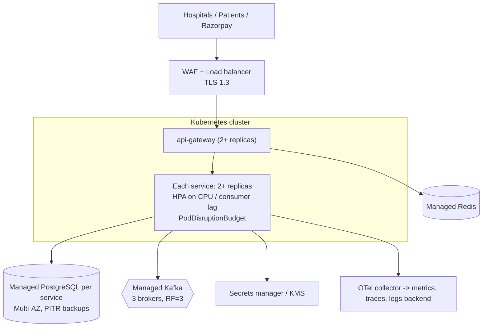

# 12 — Deployment & Local Development

## 1. Memory budget for an 8 GB laptop

Realistic numbers with the JVM settings below:

| Component | Approx. RAM |
|---|---|
| PostgreSQL 16 (all 6 databases, tuned `shared_buffers=128MB`) | 150–250 MB |
| Kafka (KRaft single node, `-Xmx512m`) | 500–700 MB |
| Redis | ~10–20 MB |
| Each Spring Boot service (`-Xmx256m`, SerialGC) | 300–400 MB |
| Gateway (reactive, `-Xmx192m`) | 250–300 MB |
| Prometheus + Grafana + Jaeger | 400–500 MB |
| Mailpit | ~20 MB |

All 7 services + all infra + observability ≈ **4–4.5 GB**, on top of the OS, Docker's VM, the IDE
(1.5–2 GB) and a browser. That does not fit comfortably, so **nothing starts by default**: you pick
profiles.

JVM flags for local containers:
`-XX:+UseSerialGC -Xss512k -XX:MaxRAMPercentage=60 -XX:TieredStopAtLevel=1 -Dspring.jmx.enabled=false`
with container memory limits in Compose. (`TieredStopAtLevel=1` trades peak performance for faster
startup and less memory — fine locally, not for load tests or production.)

## 2. Docker Compose profiles

| Profile | Starts |
|---|---|
| `infra` | postgres, kafka, redis |
| `core` | api-gateway, merchant-service, payment-service |
| `refund` | refund-service |
| `ledger` | ledger-service |
| `notify` | notification-service, mailpit |
| `recon` | reconciliation-service |
| `obs` | prometheus, grafana, jaeger |
| `tools` | kafka-ui (optional, ~250 MB) |

```bash
# Infra only; run the service you are working on from the IDE (recommended)
docker compose --profile infra up -d

# Payment flow end to end (~2.3 GB)
docker compose --profile infra --profile core up -d

# Payment + refund + ledger
docker compose --profile infra --profile core --profile refund --profile ledger up -d

# Add observability only when you need it
docker compose --profile obs up -d

# Stop everything, keep data / wipe data
docker compose --profile "*" down
docker compose --profile "*" down -v
```

**Recommended day-to-day workflow:** `infra` in Docker + one or two services from IntelliJ /
`./mvnw -pl services/payment-service spring-boot:run`. Services that are not running are not
needed: events wait in Kafka until their consumer starts. This is the event-driven design paying
off on a small laptop.

## 3. Configuration per environment

| Profile | Purpose |
|---|---|
| `local` | Running from the IDE against `infra` on localhost |
| `docker` | Running inside Compose (hostnames `postgres`, `kafka`, …) |
| `test` | Testcontainers / WireMock |
| `prod` | Example production settings: Swagger off, https-only webhooks, strict CORS |
| `provider-sim` | Opt-in simulated provider for demos without Razorpay keys |

Secrets come only from environment variables (`deploy/env/.env`, git-ignored; `.env.example`
committed with placeholders): `RAZORPAY_KEY_ID`, `RAZORPAY_KEY_SECRET`, `RAZORPAY_WEBHOOK_SECRET`,
`<SERVICE>_DB_PASSWORD`, `PII_ENCRYPTION_KEY`, `JWT_KEYSTORE_PATH`/password, `OPS_CLIENT_SECRET`.

### Razorpay sandbox

1. Create a Razorpay account and switch to **Test Mode**; generate test API keys.
2. For webhooks to reach your laptop you need a public HTTPS URL — e.g. a tunnel
   (`cloudflared tunnel --url http://localhost:8080` or ngrok). Configure two webhooks in the
   dashboard: `/webhooks/razorpay/payments` and `/webhooks/razorpay/refunds`.
3. Without a tunnel, the flow still completes: the **recovery job polls Razorpay** and converges.
   (Watching this happen is a good way to understand why polling exists.)

## 4. Production deployment architecture (reference, not built)



Kubernetes manifests are **not** in scope (they would add a lot of YAML without teaching much the
Compose setup does not). The images are built to be K8s-ready: non-root user, health probes,
graceful shutdown (`server.shutdown=graceful`), config only via env.

## 5. Dockerfiles

Multi-stage per service: Maven build stage (with dependency layer caching) → runtime on
`eclipse-temurin:21-jre-alpine` using Spring Boot **layered jars** (dependencies change rarely, so
rebuilds only push the small application layer). Runs as a non-root user.

## 6. CI/CD (GitHub Actions)

`.github/workflows/ci.yml` on push and pull request:

1. Checkout, set up Temurin JDK 21 with Maven cache.
2. `./mvnw -B verify` — compiles all modules, runs unit tests and Testcontainers integration tests
   (GitHub-hosted runners have Docker).
3. Upload test reports (Surefire/Failsafe) and JaCoCo coverage.
4. Secret scan (gitleaks).
5. On `main`: build Docker images per service (matrix) with Buildx and push to GHCR, tagged with
   the commit SHA.

The repository's existing `maven-publish.yml` (Java 11, publish on release) does not match this
project and will be replaced in Phase 8.
