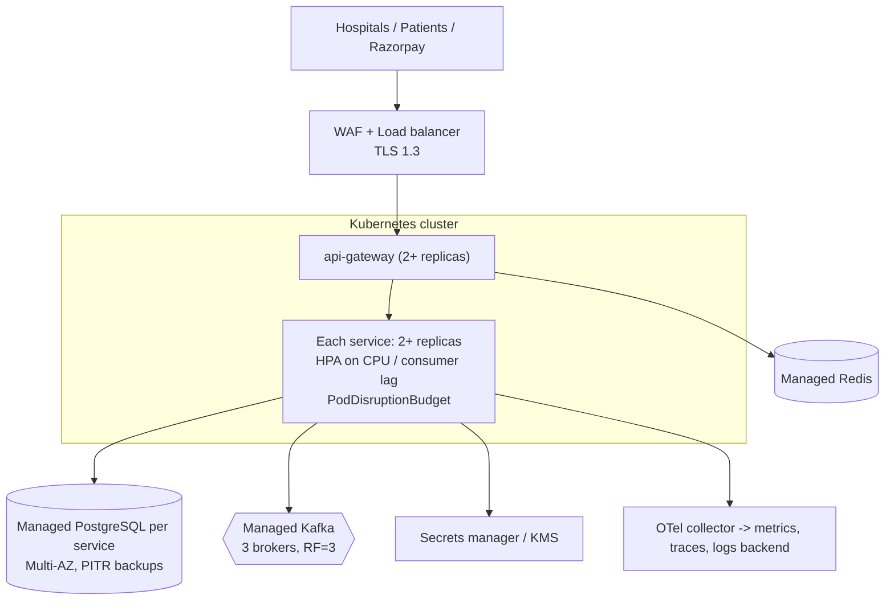

# 12 — Deployment & Local Development

## 1. Memory budget for an 8 GB laptop

Realistic numbers with the JVM settings below:

| Component | Approx. RAM |
|---|---|
| PostgreSQL 16 (all 6 databases, tuned `shared_buffers=128MB`) | 150–250 MB |
| Kafka (KRaft single node, `-Xmx512m`) | 500–700 MB |
| Redis | ~10–20 MB |
| Each Spring Boot service (`-Xmx256m`, SerialGC) | 300–400 MB |
| Gateway (reactive, `-Xmx192m`) | 250–300 MB |
| Prometheus + Grafana + Jaeger | 400–500 MB |
| Mailpit | ~20 MB |

All 7 services + all infra + observability ≈ **4–4.5 GB**, on top of the OS, Docker's VM, the IDE
(1.5–2 GB) and a browser. That does not fit comfortably, so **nothing starts by default**: you pick
profiles.

JVM flags for local containers:
`-XX:+UseSerialGC -Xss512k -XX:MaxRAMPercentage=60 -XX:TieredStopAtLevel=1 -Dspring.jmx.enabled=false`
with container memory limits in Compose. (`TieredStopAtLevel=1` trades peak performance for faster
startup and less memory — fine locally, not for load tests or production.)

## 2. Docker Compose profiles

| Profile | Starts |
|---|---|
| `infra` | postgres, kafka (KRaft, single node), redis |
| `core` | api-gateway, merchant-service, payment-service (all three exist since Phase 3) |
| `refund` | refund-service |
| `ledger` | ledger-service |
| `notify` | notification-service, mailpit (real SMTP + inbox at http://localhost:8025) |
| `ui` | console-service — the web console at http://localhost:8086 ([14](14-console.md)) |
| `recon` | reconciliation-service |
| `obs` | prometheus, grafana, jaeger |
| `tools` | kafka-ui (optional, ~250 MB) |

```bash
alias hpg='docker compose -f deploy/docker-compose.yml'   # convenience

# Infra only; run the service you are working on from the IDE (recommended)
hpg --profile infra up -d

# Gateway, merchant-service and payment-service in Docker as well
./mvnw -DskipTests clean package
hpg --profile infra --profile core up -d --build

# Add notifications (notification-service + Mailpit)
hpg --profile infra --profile core --profile notify up -d --build

# Add the web console (it only needs the gateway, so `notify` is optional)
hpg --profile infra --profile core --profile ui up -d --build
./scripts/smoke-test-console.sh

# Later phases add: --profile refund --profile ledger --profile recon --profile obs

# Stop everything, keep data / wipe data
hpg --profile "*" down
hpg --profile "*" down -v
```

Measured in Phase 4 (`docker stats`, idle after the smoke tests), `infra` + `core` + `notify`:
kafka 362 MiB, notification-service 279 MiB, payment-service 267 MiB, merchant-service 261 MiB,
api-gateway 204 MiB, postgres 102 MiB, mailpit 21 MiB, redis 5 MiB — about **1.5 GB** in total.
Leave out `--profile notify` and it is about 1.2 GB. Adding `--profile ui` costs about 250 MiB
(console-service, `mem_limit: 384m`), so `infra` + `core` + `notify` + `ui` is about **1.75 GB** —
the full set used while building Phase 4's console.

**Use `clean package`, not `package`.** When only a shared module (`platform/*`) changes, Maven leaves
the services' existing fat jars in place, and the Docker image then ships a stale copy of the shared
code. This cost an hour of confusion in Phase 4; `clean` makes it impossible. For the same reason, run
tests from the repository root (`./mvnw verify`) rather than inside one service directory: a single
module resolves `platform/*` from your local Maven repository, which may be older than your working
copy.

**Two Kafka listeners.** Containers reach the broker as `kafka:9092`; a service you run from the IDE
reaches the same broker as `localhost:29092` (set `KAFKA_BOOTSTRAP_SERVERS` in `deploy/env/.env`).
A Kafka client always connects to the address the broker advertises, so one listener cannot serve both.

**Recommended day-to-day workflow:** `infra` in Docker + one or two services from IntelliJ /
`./mvnw -pl services/merchant-service spring-boot:run -Dspring-boot.run.profiles=local`. The `local`
profile makes the service read `deploy/env/.env` (the same file Compose uses). It is deliberately a
profile and not the default, so automated tests can never pick up a developer's local settings — an
earlier version imported the file unconditionally and a test silently changed behaviour once a `.env`
existed. Services that are not running are not
needed: events wait in Kafka until their consumer starts. This is the event-driven design paying
off on a small laptop.

## 3. Configuration per environment

| Profile | Purpose |
|---|---|
| (none) | Defaults for running on localhost; secrets must come from environment variables |
| `local` | Same, plus reads `deploy/env/.env` |
| `docker` | Running inside Compose (hostnames `postgres`, `kafka`, …) |
| `test` | Testcontainers / WireMock |
| `prod` | Example production settings: Swagger off, https-only webhooks, strict CORS |
| `provider-sim` | Opt-in simulated provider for demos without Razorpay keys |

The console reads three settings of its own: `HPG_GATEWAY_URI` (the edge it calls — `api-gateway:8080`
inside Compose), `HPG_TOKEN_ISSUER` (must equal the `iss` claim merchant-service puts in tokens, or
token verification fails) and `HPG_CONSOLE_SECURE_COOKIES`, which must be `true` behind TLS. It stores
nothing and has no database user.

Secrets come only from environment variables (`deploy/env/.env`, git-ignored; `.env.example`
committed with placeholders): `RAZORPAY_KEY_ID`, `RAZORPAY_KEY_SECRET`, `RAZORPAY_WEBHOOK_SECRET`,
`<SERVICE>_DB_PASSWORD`, `PII_ENCRYPTION_KEY`, `JWT_KEYSTORE_PATH`/password, `OPS_CLIENT_SECRET`.

### Razorpay sandbox

1. Create a Razorpay account and switch to **Test Mode**; generate test API keys.
2. For webhooks to reach your laptop you need a public HTTPS URL — e.g. a tunnel
   (`cloudflared tunnel --url http://localhost:8080` or ngrok). Configure two webhooks in the
   dashboard: `/webhooks/razorpay/payments` and `/webhooks/razorpay/refunds`.
3. Without a tunnel, the flow still completes: the **recovery job polls Razorpay** and converges.
   (Watching this happen is a good way to understand why polling exists.)

## 4. Production deployment architecture (reference, not built)



Kubernetes manifests are **not** in scope (they would add a lot of YAML without teaching much the
Compose setup does not). The images are built to be K8s-ready: non-root user, health probes,
graceful shutdown (`server.shutdown=graceful`), config only via env.

## 5. Dockerfiles

One Dockerfile per service. The jar is built on the host (`./mvnw package`) and the Dockerfile only
packages it: running Maven inside Docker would keep a second multi-GB dependency cache on an 8 GB
laptop, and CI builds the jar once for both tests and the image. Two stages: extract Spring Boot
**layers** (dependencies change rarely, so rebuilds only replace the small application layer) →
runtime on `eclipse-temurin:21-jre-alpine` as a non-root user. The gateway serves the API on 8080 and
actuator on a separate port 9080 that is never published publicly.

## 6. CI/CD (GitHub Actions)

`.github/workflows/ci.yml` on push and pull request:

1. Checkout, set up Temurin JDK 21 with Maven cache.
2. `./mvnw -B verify` — compiles all modules, runs unit tests and Testcontainers integration tests
   (GitHub-hosted runners have Docker).
3. Upload test reports (Surefire/Failsafe) and JaCoCo coverage.
4. Secret scan (gitleaks).
5. On `main`: build Docker images per service (matrix) with Buildx and push to GHCR, tagged with
   the commit SHA.

Phase 2 ships steps 1–3 (`.github/workflows/ci.yml`); the old `maven-publish.yml` (Java 11) was
removed. Steps 4–5 arrive in Phase 8.
