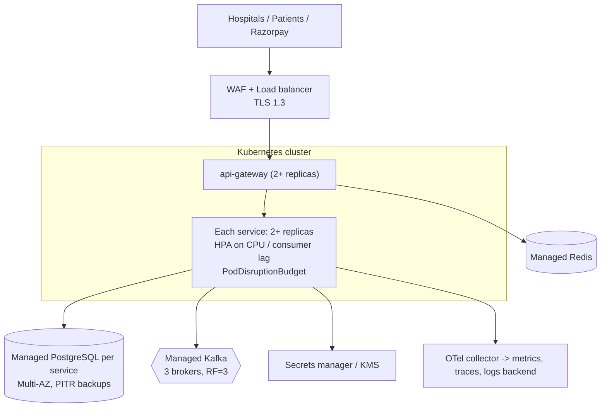

# 12 — Deployment & Local Development

## 1. Memory budget for an 8 GB laptop

Realistic numbers with the JVM settings below:

| Component | Approx. RAM |
|---|---|
| PostgreSQL 16 (all 6 databases, tuned `shared_buffers=128MB`) | 150–250 MB |
| Kafka (KRaft single node, `-Xmx512m`) | 500–700 MB |
| Redis | ~10–20 MB |
| Each Spring Boot service (`-Xmx256m`, SerialGC) | 300–400 MB |
| Gateway (reactive, `-Xmx192m`) | 250–300 MB |
| Prometheus + Grafana + Jaeger | 400–500 MB |
| Mailpit | ~20 MB |

All 7 services + all infra + observability ≈ **4–4.5 GB**, on top of the OS, Docker's VM, the IDE
(1.5–2 GB) and a browser. That does not fit comfortably, so **nothing starts by default**: you pick
profiles.

JVM flags for local containers:
`-XX:+UseSerialGC -Xss512k -XX:MaxRAMPercentage=60 -XX:TieredStopAtLevel=1 -Dspring.jmx.enabled=false`
with container memory limits in Compose. (`TieredStopAtLevel=1` trades peak performance for faster
startup and less memory — fine locally, not for load tests or production.)

## 2. Docker Compose profiles

| Profile | Starts |
|---|---|
| `infra` | postgres, kafka, redis |
| `core` | api-gateway, merchant-service, payment-service |
| `refund` | refund-service |
| `transactions` | transaction-service (history, status, ledger) |
| `dashboard` | web dashboard for hospitals and operations on :8090 (nginx, ~5 MB) |
| `notify` | notification-service, mailpit |
| `recon` | reconciliation-service (local: settlement window 0 days, so missing items show at once) |
| `obs` | prometheus, grafana, jaeger |
| `auth` | keycloak: single sign-on for dashboard users at http://localhost:8090/auth (~500 MB) |
| `tools` | kafka-ui (optional, ~250 MB) |

```bash
alias hpg='docker compose -f deploy/docker-compose.yml'   # convenience

# Infra only; run the service you are working on from the IDE (recommended)
hpg --profile infra up -d

# Gateway + merchant-service in Docker as well (Phase 2: measured ~550 MB for the whole stack)
./mvnw -DskipTests package
hpg --profile infra --profile core up -d --build

# The other services: --profile refund --profile transactions --profile notify --profile recon --profile dashboard
# Observability: --profile obs, with HPG_TRACE_EXPORT=true to send traces to Jaeger

# Stop everything, keep data / wipe data
hpg --profile "*" down
hpg --profile "*" down -v
```

Measured in Phase 3 (`docker stats` after both smoke tests): api-gateway 225 MiB, merchant-service
272 MiB, payment-service 262 MiB, postgres 82 MiB, redis 5 MiB — about 850 MB for the `infra` + `core`
profiles.

Measured in Phase 7 with every profile (`docker stats` after the smoke tests): the six services 285–315 MiB
each, gateway 263 MiB, Kafka 404 MiB, PostgreSQL 144 MiB, Prometheus 55 MiB, Grafana 58 MiB, Jaeger 53 MiB,
Mailpit, Redis and the dashboard under 15 MiB each: about **2.8 GB** in total. The `obs` profile adds about
170 MB.

Measured with every implemented service (`infra core refund transactions notify`, after
`smoke-test-phase4.sh`): gateway 205 MiB, merchant 246, payment 284, refund 263, transaction 258,
notification 268, Kafka 446, Postgres 147, Mailpit 11, Redis 3 — about **2.1 GB**.

**Recommended day-to-day workflow:** `infra` in Docker + one or two services from IntelliJ /
`./mvnw -pl services/merchant-service spring-boot:run -Dspring-boot.run.profiles=local`. The `local`
profile makes the service read `deploy/env/.env` (the same file Compose uses). It is deliberately a
profile and not the default, so automated tests can never pick up a developer's local settings — an
earlier version imported the file unconditionally and a test silently changed behaviour once a `.env`
existed. Services that are not running are not
needed: events wait in Kafka until their consumer starts. This is the event-driven design paying
off on a small laptop.

## 3. Configuration per environment

| Profile | Purpose |
|---|---|
| (none) | Defaults for running on localhost; secrets must come from environment variables |
| `local` | Same, plus reads `deploy/env/.env` |
| `docker` | Running inside Compose (hostnames `postgres`, `kafka`, …) |
| `test` | Testcontainers / WireMock |
| `prod` | Example production settings: Swagger off, https-only webhooks, strict CORS |
| `provider-sim` | Opt-in simulated provider for demos without Razorpay keys |

Secrets come only from environment variables (`deploy/env/.env`, git-ignored; `.env.example`
committed with placeholders): `RAZORPAY_KEY_ID`, `RAZORPAY_KEY_SECRET`, `RAZORPAY_WEBHOOK_SECRET`,
`<SERVICE>_DB_PASSWORD`, `PII_ENCRYPTION_KEY`, `JWT_KEYSTORE_PATH`/password, `OPS_CLIENT_SECRET`.

### Razorpay sandbox

1. Create a Razorpay account and switch to **Test Mode**; generate test API keys.
2. For webhooks to reach your laptop you need a public HTTPS URL — e.g. a tunnel
   (`cloudflared tunnel --url http://localhost:8080` or ngrok). Configure two webhooks in the
   dashboard: `/webhooks/razorpay/payments` and `/webhooks/razorpay/refunds`.
3. Without a tunnel, the flow still completes: the **recovery job polls Razorpay** and converges.
   (Watching this happen is a good way to understand why polling exists.)

## 4. Production deployment architecture (reference, not built)



Kubernetes manifests are **not** in scope (they would add a lot of YAML without teaching much the
Compose setup does not). The images are built to be K8s-ready: non-root user, health probes,
graceful shutdown (`server.shutdown=graceful`), config only via env.

## 5. Dockerfiles

One Dockerfile per service. The jar is built on the host (`./mvnw package`) and the Dockerfile only
packages it: running Maven inside Docker would keep a second multi-GB dependency cache on an 8 GB
laptop, and CI builds the jar once for both tests and the image. Two stages: extract Spring Boot
**layers** (dependencies change rarely, so rebuilds only replace the small application layer) →
runtime on `eclipse-temurin:21-jre-alpine` as a non-root user. The gateway serves the API on 8080 and
actuator on a separate port 9080 that is never published publicly.

## 6. CI/CD (GitHub Actions)

`.github/workflows/ci.yml` on push and pull request:

1. Checkout, set up Temurin JDK 21 with Maven cache.
2. `./mvnw -B verify` — compiles all modules, runs unit tests and Testcontainers integration tests
   (GitHub-hosted runners have Docker).
3. Upload test reports (Surefire/Failsafe) and JaCoCo coverage.
4. Secret scan (gitleaks).
5. On `main`: build Docker images per service (matrix) with Buildx and push to GHCR, tagged with
   the commit SHA.

Phase 2 ships steps 1–3 (`.github/workflows/ci.yml`); the old `maven-publish.yml` (Java 11) was
removed. Steps 4–5 arrive in Phase 8.

## Kubernetes

The production deployment is a Helm chart (`deploy/helm/hpg`) plus operator-managed PostgreSQL and Kafka;
see [deploy/k8s/README.md](../deploy/k8s/README.md). Two ways to try the HA behaviour locally:

- `./scripts/ha-check.sh`: Compose with **two replicas of every service** (`deploy/docker-compose.ha.yml`), then
  the smoke tests and duplicate checks. About 4.5 GB of RAM.
- `./scripts/k8s-demo-up.sh`: the chart on a single-node cluster (kind, k3d, minikube or Docker Desktop).
