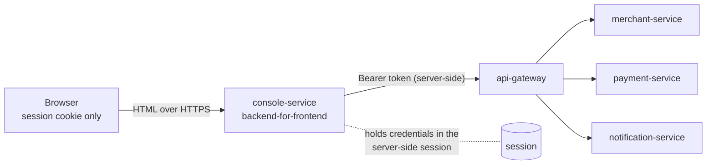

# 14 — The Web Console

A single application serving two audiences: **hospital staff** (their payments, their configuration,
their API keys) and **operations** (merchant onboarding and lifecycle, notification delivery). The
patient never sees it — patients get the hosted checkout page, which belongs to payment-service.

## 1. What it is, and what it is not

The console is a **backend-for-frontend**. It owns no database, no business rules and no credentials
of its own. Every page is assembled from the same public APIs a hospital's own system would call, and
it calls them **through the gateway**, so what the console shows went through the same routing,
authentication and rate limits as any other client. A page that works here is evidence the public API
works.

If a rule ever looks like it lives in the console, that is a bug. Whether a payment can be captured,
whether an amount is within a hospital's limits, whether a reference is already in use — payment-service
decides all of it, and the console shows what it said, in the service's own words.



## 2. Why a backend-for-frontend

The obvious alternative is a single-page app that holds an access token in JavaScript. That token is
then readable by any script that reaches the page — an injected one, a compromised dependency, a
browser extension — and with it an attacker can call the payment API directly as that hospital.

So the browser gets a session cookie and nothing else:

| Concern | How it is handled |
|---|---|
| Access tokens | Never leave the server. The session holds the credentials; the console mints a token when it needs one. |
| Session cookie | `HttpOnly` (unreadable from JavaScript), `SameSite=Lax`, and `Secure` behind TLS (`HPG_CONSOLE_SECURE_COOKIES=true`). |
| CSRF | On. A cookie-authenticated app without it lets any other site submit forms as the signed-in person — "capture this payment" among them. |
| Session fixation | The session id is replaced on sign-in, so an id planted beforehand is worthless. |
| Content Security Policy | `default-src 'self'`, no inline scripts or styles anywhere. |
| Idempotency | Every state-changing call carries an `Idempotency-Key`, so a double-clicked button cannot create two payments. |

A test asserts the first of these directly: `ConsoleIT#noTokenOrSecretIsEverSentToTheBrowser`.

## 3. Signing in

There is no user table. Signing in **is** an OAuth2 client-credentials exchange against the gateway:
if a token comes back the credentials are good, and the token's `roles` claim says what the person may
do. The console then verifies that token against the published signing keys before trusting its
claims — it arrived over our own call, so this is belt and braces, but reading claims out of an
unverified JWT is the kind of shortcut that quietly becomes a vulnerability.

| Who | Signs in with | Role |
|---|---|---|
| Hospital staff | an API key id (`hpgk_…`) and its secret | `MERCHANT`, plus the `mid` claim naming their hospital |
| Operations | the ops client id and secret (`HPG_OPS_CLIENT_SECRET`) | `OPS` |

Because roles come from the token, the console cannot disagree with merchant-service about who may do
what, and a suspended hospital stops being able to sign in the moment it is suspended.

> **Demo-grade simplification, stated plainly.** Asking hospital staff to type an API key secret into a
> browser is not how a real product works: API keys belong in servers. In a real deployment, people
> would have their own accounts — hospital staff behind the hospital's identity provider, operators
> behind the company's, both with multi-factor authentication — and the console would never see a key
> secret. That is a user-management feature, not a console feature, so it is written down here rather
> than half-built.

## 4. What each role sees

**Hospital**

| Page | What it does |
|---|---|
| Payments | Filter by status and bill reference. Refreshes itself while a payment is still in flight. |
| Payment detail | Attempts at the provider, and the full status history: which of the three signals (browser callback, provider webhook, our polling) moved it, and why. |
| New payment | Creates a payment and shows the checkout link to send the patient. |
| Settings | Profile, payment methods, limits, capture mode, webhook URL, patient notification preferences, webhook secret rotation. |
| API keys | Create (secret shown once), list, revoke. |

**Operations**

| Page | What it does |
|---|---|
| Hospitals | List and filter by status; activate, suspend, deactivate — each with a mandatory reason that goes to the audit log. |
| Notification delivery | What was sent, what is being retried and when the next attempt is due, what was given up on; every attempt with its response and duration; requeue a dead notification once the hospital has fixed its endpoint. |

## 5. Server-rendered, with about sixty lines of JavaScript

Thymeleaf templates, plain CSS, no Node and no build step. The reasons are specific rather than
ideological: nothing new in CI, no `node_modules`, about 250 MB of memory rather than a second
toolchain on an 8 GB laptop, and the project stays all-Java — which is what this codebase is for.

The only JavaScript does three things: refresh a region while something can still change, copy a value
to the clipboard, and confirm an action that moves money. HTMX would do all of that and much more, but
these are the only three things the console needs, so there is nothing vendored and nothing to keep up
to date.

**Live refresh** is deliberately conditional. The server decides whether a page is worth polling — the
payment list sets `data-live-active="true"` only when a payment is actually in flight — so a page full
of captured payments makes no requests at all, and a background tab makes none either.

## 6. Running it

```bash
docker compose -f deploy/docker-compose.yml --profile infra --profile core --profile notify --profile ui up -d --build
# then open http://localhost:8086
./scripts/smoke-test-console.sh     # drives the whole thing with curl
```

From the IDE instead: run `ConsoleServiceApplication` with profile `local` (it then reads
`deploy/env/.env`, and templates reload without a restart).

| Setting | Default | Notes |
|---|---|---|
| `HPG_GATEWAY_URI` | `http://localhost:8080` | In Compose the console reaches the gateway as `http://api-gateway:8080` |
| `HPG_TOKEN_ISSUER` | `http://localhost:8081` | Must match the `iss` claim merchant-service puts in tokens |
| `HPG_CONSOLE_SECURE_COOKIES` | `false` | Set to `true` behind TLS |

## 7. Known limits

- **Sessions are in memory.** One instance only. With more than one, the obvious step is
  Spring Session backed by the Redis already running in the `infra` profile.
- **No refunds, ledger or reconciliation pages** — those services do not exist yet (Phases 5 and 6).
  The console grows with them.
- **No dashboard.** Counts would mean extra API calls per page load for numbers nobody acts on; the
  filtered lists are what operations actually use.
- **Not behind the gateway.** The console is a *client* of the edge, not a service behind it. In
  production it would sit behind the same ingress and TLS, with its own hostname.
